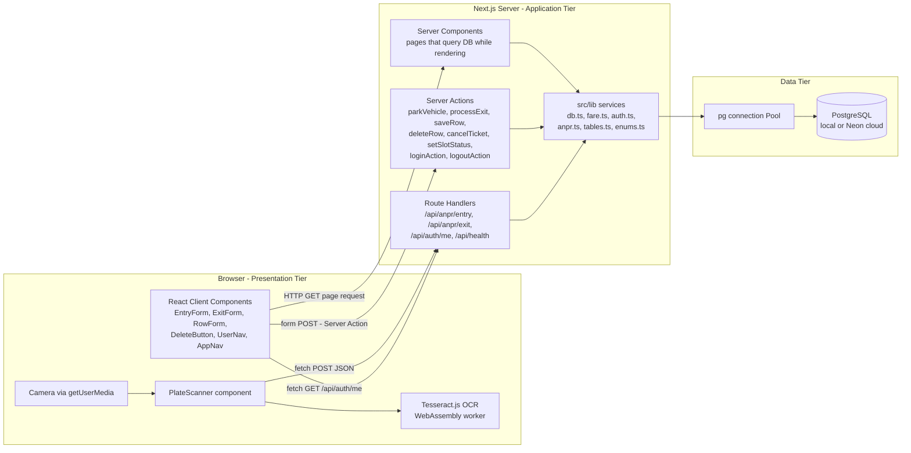
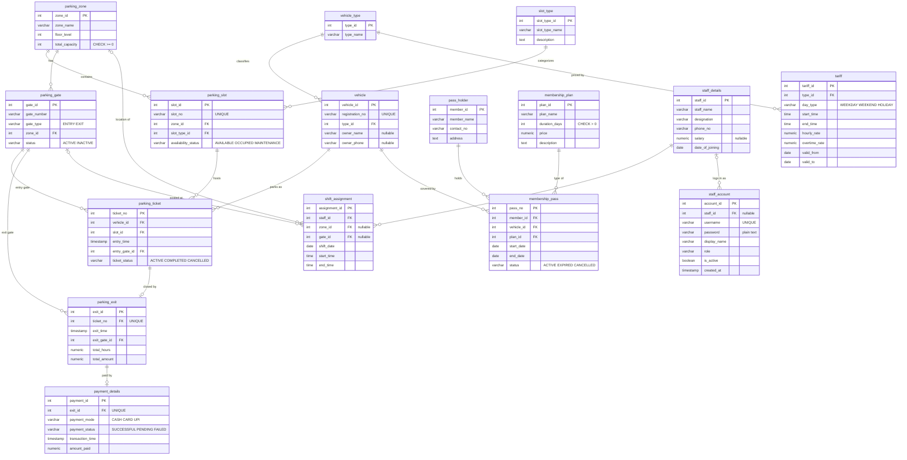
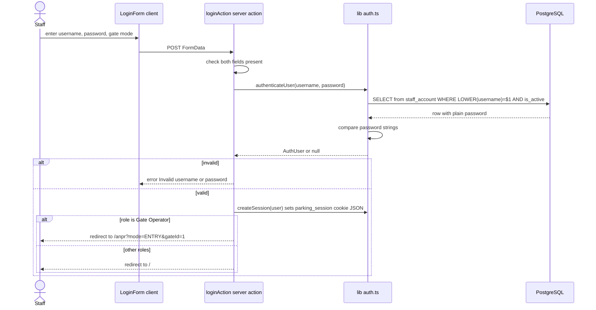
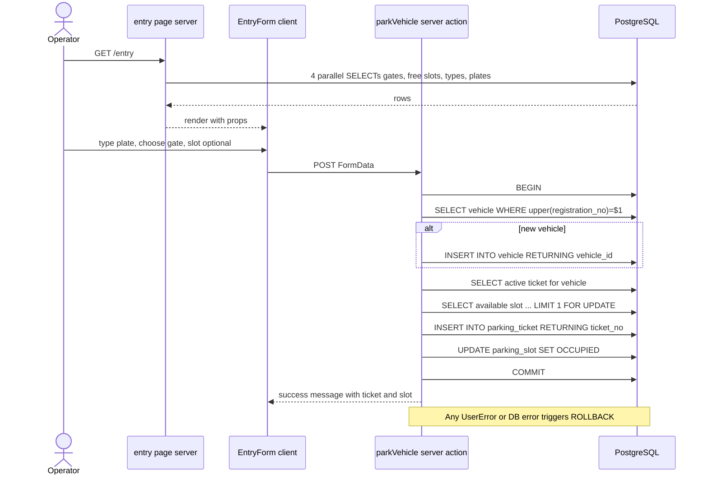
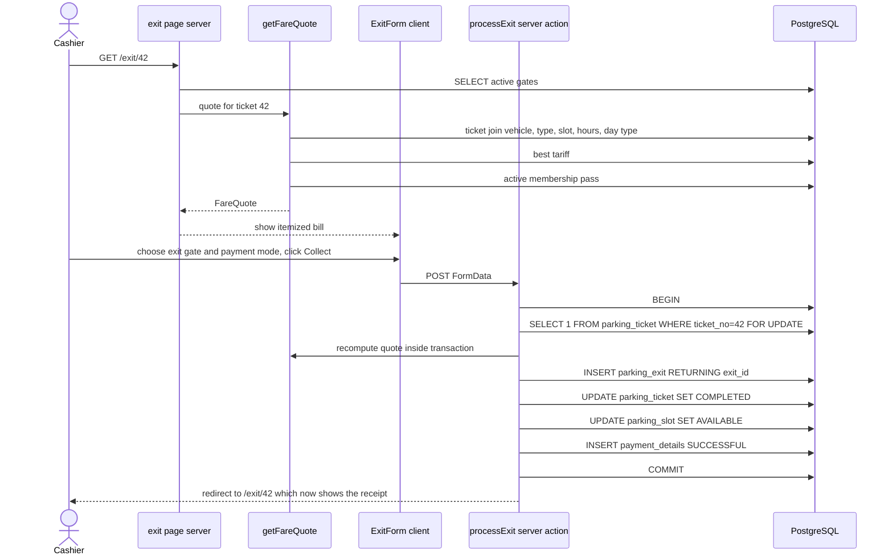
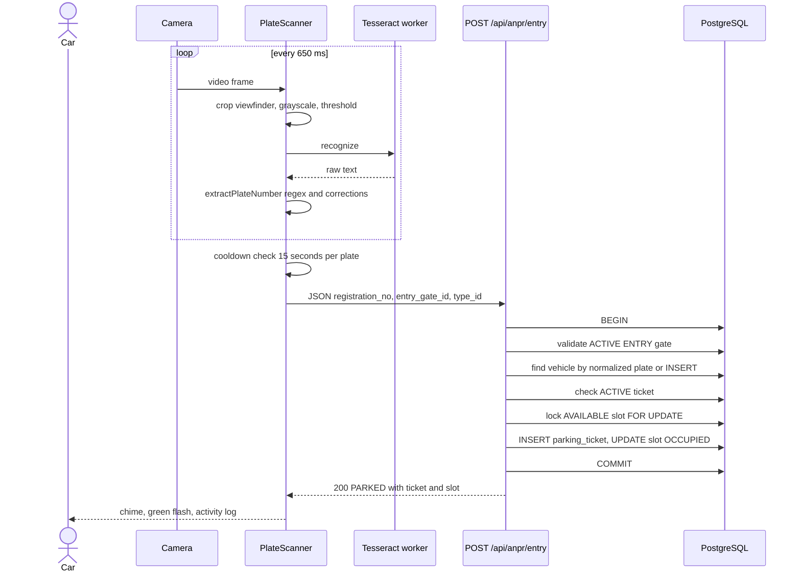
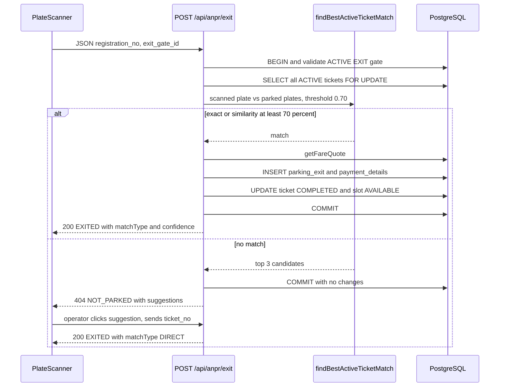
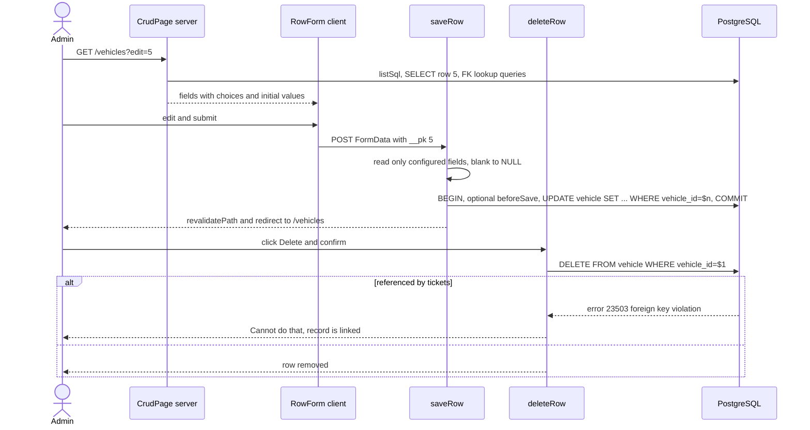

# Parking Management System — Technical Report & Viva Preparation

**Project:** Parking Management System (Next.js + PostgreSQL + ANPR)
**Repository:** `parking_management/` (single commit `1703f73`, "Initial commit: Complete Parking Management System with Next.js, Neon DB, and ANPR")
**Prepared from:** a full read of the source code, SQL schema, migrations, seed data and scripts. Everything in this report is based on the actual implementation. Where something is **not implemented**, the report says so.

---

## Table of Contents

- [Part 1: Project Overview](#part-1-project-overview)
- [Part 2: Technology Stack Deep Dive](#part-2-technology-stack-deep-dive)
- [Part 3: Complete Database Documentation](#part-3-complete-database-documentation)
- [Part 4: Complete Functionality Explanation](#part-4-complete-functionality-explanation)
- [Part 5: Backend Architecture](#part-5-backend-architecture)
- [Part 6: Frontend Architecture](#part-6-frontend-architecture)
- [Part 7: Complete Application Workflows](#part-7-complete-application-workflows)
- [Part 8: Important Technical Concepts](#part-8-important-technical-concepts)
- [Part 9: Security and Error Handling](#part-9-security-and-error-handling)
- [Part 10: Limitations and Future Improvements](#part-10-limitations-and-future-improvements)
- [Part 11: Viva Question Bank](#part-11-viva-question-bank)
- [Part 12: Last-Minute Viva Revision](#part-12-last-minute-viva-revision)

---

## Part 1: Project Overview

### 1.1 What the project does

This is a **web-based Parking Management System** for staff who run a multi-level car park. The seed data models a **5-level shopping-mall car park in Ahmedabad with 320 parking bays** (slots), 8 gates, 26 staff members and about 930 historical parking tickets.

The system lets staff:

- Record a **vehicle entry**, which issues a **parking ticket** and marks a **slot** as occupied.
- Record a **vehicle exit**, which **calculates the parking fee** from a **tariff**, records the **exit** and **payment**, and frees the slot.
- Do both of the above automatically with **ANPR** (Automatic Number Plate Recognition): the browser reads the number plate from a camera with **OCR** (Tesseract.js).
- Manage the facility master data: **zones, slots, slot types, gates, tariffs, vehicles, vehicle types, members, membership plans, membership passes, staff and shifts**.
- View a **live dashboard** (occupancy, revenue), a **slot board**, **active tickets** and **history**.

It is an **internal staff application**. Customers do not log in.

### 1.2 The problem it solves

| Manual / traditional problem | How this project solves it |
|---|---|
| Paper tickets get lost; nobody knows which car is in which bay | Every stay is a row in `parking_ticket` linked to a `vehicle` and a `parking_slot` |
| Staff don't know how many bays are free | `parking_slot.availability_status` + Dashboard + Slot Board show live occupancy |
| Fee calculation is error-prone | `getFareQuote()` in `src/lib/fare.ts` computes the fee in SQL from the `tariff` table |
| Gate staff must type plate numbers | ANPR scanner reads plates from the camera and calls the API automatically |
| OCR misreads (e.g., `Y` vs `V`, `0` vs `O`) block exits | OCR-weighted fuzzy matching (`findBestActiveTicketMatch`) finds the right parked car |
| Regular parkers pay every time | Membership passes make the stay free while the pass is valid |
| Staff rosters kept separately | `shift_assignment` links staff to zones/gates by date and time |

### 1.3 Objectives and key features

**Objectives**

1. Design a **normalized relational database** for a parking facility with proper keys and constraints.
2. Build a web front-end that performs **CRUD** operations on every entity.
3. Implement the core business workflow — **entry → ticket → exit → fare → payment** — safely using **database transactions**.
4. Add an **automation layer (ANPR)** that converts a camera image into a database transaction.

**Key features (all implemented)**

- Dashboard with occupancy %, active tickets, revenue today / all time, per-zone occupancy
- ANPR Gate Scanner (live camera OCR, image upload OCR, manual plate input) for entry and exit
- Fuzzy plate matching with "Did you mean…?" suggestions on exit
- Manual Vehicle Entry form with auto slot assignment
- Active Tickets list with live "parked for" duration, Exit and Cancel
- Exit page with itemized fare quote, payment mode selection, and receipt view
- History of the last 200 closed tickets
- Slot Board (visual grid by zone) with "Set maintenance" / "Mark available"
- Generic CRUD screens for 11 tables, driven by one config file (`src/lib/tables.ts`)
- Membership Plans page with pricing cards, filter tabs and "Most popular" badge
- Login / logout with a session cookie, role-based redirect for Gate Operators
- Health check endpoint (`/api/health`)
- Database migration, seeding and verification scripts

### 1.4 Technologies used

| Layer | Technology | Version (from `package.json` / `node_modules`) |
|---|---|---|
| Full-stack framework | **Next.js** (App Router, Turbopack) | 16.4.3 |
| UI library | **React** | 19.3.0 |
| Language | **TypeScript** | ^5 |
| Database | **PostgreSQL** (local Postgres.app v18; cloud: **Neon**) | 18 |
| DB driver | **node-postgres (`pg`)** — raw SQL, **no ORM** | 8.23.1 |
| OCR | **Tesseract.js** (WebAssembly, runs in the browser) | 7.0.0 |
| Styling | **Tailwind CSS** v4 (via `@tailwindcss/turbopack`) | ^4 |
| Guard package | **`server-only`** | 0.0.1 |
| Linting | ESLint 9 + `eslint-config-next` | — |
| Browser APIs | `getUserMedia` (camera), Canvas 2D, Web Audio | — |
| Tooling | Bash + `psql` / `pg_dump` scripts, Node `.mjs` test scripts | — |

### 1.5 Why each technology was selected

- **Next.js** — one codebase holds both the UI and the backend. Server Components can query the database directly, Server Actions handle form submissions without writing REST endpoints, and Route Handlers provide JSON APIs where needed (ANPR).
- **React 19** — component-based UI. `useActionState` gives forms built-in pending and error state.
- **TypeScript** — catches type mistakes at compile time (e.g., the `FareQuote` type, `TableConfig` type).
- **PostgreSQL** — a mature RDBMS with strong support for **constraints (PK, FK, UNIQUE, CHECK)**, **transactions**, **row locking (`FOR UPDATE`)**, and rich SQL (`FILTER`, `EXTRACT`, `regexp_replace`). This is a DBMS project, so the database enforces the rules.
- **Neon** — serverless cloud PostgreSQL, so the deployed app has a hosted database. The scripts also mention Supabase as an alternative.
- **`pg` without an ORM** — the project shows real SQL (joins, aggregates, locks). That suits a DBMS course and gives full control over queries.
- **Tesseract.js** — OCR runs **entirely in the browser** (WebAssembly). It needs no paid API and no Python backend, and images never leave the device.
- **Tailwind CSS** — utility classes for a responsive layout (desktop sidebar plus mobile bottom tabs).

### 1.6 Overall system architecture

The system is a **three-tier architecture**:

1. **Presentation tier** — React components rendered in the browser (plus the OCR engine and camera).
2. **Application tier** — the Next.js server: Server Components, Server Actions, Route Handlers and the `src/lib` service modules.
3. **Data tier** — the PostgreSQL database (local or Neon).



### 1.7 How the components communicate

There are **three communication channels** between browser and server:

| Channel | Used by | How it works |
|---|---|---|
| **Server Component rendering** (HTTP GET) | Every page (`/`, `/tickets`, `/slots`, CRUD pages…) | The page component runs **on the server**, calls `query()` to read PostgreSQL, and sends ready-made HTML/RSC payload to the browser. The browser never sees SQL. |
| **Server Actions** (HTTP POST, managed by Next.js) | Forms: entry, exit, CRUD save/delete, cancel ticket, slot status, login/logout | A function marked `"use server"` is passed to `<form action={...}>`. Next.js serializes the `FormData`, POSTs it to the server, runs the function, and returns the result (or a redirect). |
| **REST Route Handlers** (JSON over `fetch`) | ANPR scanner, user badge, health check | Classic `POST /api/anpr/entry` with a JSON body, returning a JSON response with HTTP status codes (200, 400, 404, 409, 500). |

The **server talks to the database** through a single shared **`pg.Pool`** (`src/lib/db.ts`) using **parameterized SQL**.

**External services:**

- **Neon** (cloud PostgreSQL) — connected via `DATABASE_URL` with SSL.
- **Google Fonts** — `next/font/google` loads the Geist fonts (Next.js downloads and self-hosts them at build time).
- **Tesseract.js** — with default settings (no `langPath`/`corePath` override in the code), the library downloads its WebAssembly core and English language data from a public CDN the first time the scanner loads.

---

## Part 2: Technology Stack Deep Dive

### 2.1 Next.js 16 (App Router)

- **What it is:** a React framework that adds server-side rendering, file-based routing, and backend features (Server Actions, Route Handlers) to React.
- **Why used:** one project for frontend and backend. Pages can query the DB directly.
- **Where implemented:** everything under `web/src/app/`. Configuration in `web/next.config.ts`.
- **Responsibility:** routing, rendering pages, handling form submissions, exposing JSON APIs, cache revalidation.
- **Interaction:** calls `src/lib/db.ts` → `pg` → PostgreSQL; renders React components.

**File-based routing** — the folder name is the URL:

| Folder | URL |
|---|---|
| `src/app/page.tsx` | `/` |
| `src/app/tickets/page.tsx` | `/tickets` |
| `src/app/exit/[ticketNo]/page.tsx` | `/exit/123` (dynamic segment) |
| `src/app/api/anpr/entry/route.ts` | `POST /api/anpr/entry` |

**Config (`web/next.config.ts`):**

```ts
const nextConfig: NextConfig = {
  cacheComponents: true,      // Next 16 "Cache Components" mode
  partialPrefetching: true,
  turbopack: {
    rules: {
      "*.css": { loaders: ["@tailwindcss/turbopack"], as: "*.css" },
    },
  },
};
```

- **`cacheComponents: true`** — Next.js tries to pre-render pages at build time. Data that must be fresh per request has to be inside a `<Suspense>` boundary and must signal it is dynamic. That is why **every page wraps its content in `<Suspense>`** and why `query()` calls `await connection()` first (see 2.4).

**Key Next.js APIs used in this project:**

| API | Where | Purpose |
|---|---|---|
| `"use server"` | `crud-actions.ts`, `entry/actions.ts`, `exit/[ticketNo]/actions.ts`, `tickets/actions.ts`, `slots/actions.ts`, `login/actions.ts` | Marks functions as Server Actions |
| `"use client"` | `EntryForm.tsx`, `ExitForm.tsx`, `RowForm.tsx`, `DeleteButton.tsx`, `PlateScanner.tsx`, `LoginForm.tsx`, `UserNav.tsx`, `AppNav.tsx` | Marks components that run in the browser (state, events) |
| `revalidatePath()` | after every write | Clears cached page data so the next render shows fresh DB data |
| `redirect()` | `saveRow`, `processExit`, `loginAction`, `logoutAction`, login page | Server-side redirect |
| `notFound()` | `exit/[ticketNo]/page.tsx` | Renders 404 for a bad ticket number |
| `cookies()` | `src/lib/auth.ts` | Read/write the session cookie |
| `connection()` | `src/lib/db.ts` | Forces per-request (dynamic) rendering |
| `NextResponse.json()` | API routes | Returns JSON with status codes |
| `PageProps<"/route">`, `LayoutProps` | pages | Auto-generated typed route props |

### 2.2 React 19

- **What it is:** a UI library for building components.
- **Why used:** interactive forms, the live scanner and the navigation.
- **Where:** all `.tsx` files. Client components use hooks.
- **Hooks used:**

| Hook | Where | Purpose |
|---|---|---|
| `useActionState` | `EntryForm`, `ExitForm`, `RowForm`, `DeleteButton`, `LoginForm` | Runs a Server Action and tracks `[state, action, pending]` |
| `useState` | `PlateScanner`, `EntryForm`, `LoginForm`, `UserNav`, `AppNav` | Local UI state |
| `useEffect` | `PlateScanner` (OCR worker, camera, scan loop), `UserNav` (fetch user) | Side effects |
| `useRef` | `PlateScanner` (video element, OCR worker, cooldown map) | Mutable values that don't re-render |
| `useCallback` / `useMemo` | `PlateScanner`, `LoginForm` | Memoize functions and filtered gate lists |
| `<Suspense>` | every page | Shows "Loading…" while server data streams in |

Example — `src/app/entry/EntryForm.tsx`:

```tsx
const [state, action, pending] = useActionState<EntryState, FormData>(parkVehicle, { error: null });
...
<form action={action}>
  ...
  {state.error && <p className="error">{state.error}</p>}
  <button disabled={pending || gates.length === 0}>
    {pending ? "Issuing…" : "Issue ticket"}
  </button>
</form>
```

### 2.3 TypeScript

- **Why:** type safety across server and client. For example, `TableConfig` in `src/lib/tables.ts` makes every CRUD config declare `table`, `pk`, `fields`, `listSql` and `columns`. `satisfies Record<string, TableConfig>` checks all 11 configs at compile time.
- `as const` arrays in `src/lib/enums.ts` give literal types such as `"AVAILABLE" | "OCCUPIED" | "MAINTENANCE"`.

### 2.4 PostgreSQL and node-postgres (`pg`)

- **What:** PostgreSQL is the relational database. `pg` is the Node.js driver.
- **Why:** this is a DBMS project. Constraints, transactions and row locks are enforced by the database.
- **Where:** `src/lib/db.ts` (connection, `query`, `withTransaction`, `dbErrorMessage`). SQL appears in pages, actions, API routes, `fare.ts`, `auth.ts` and `tables.ts`.
- **No ORM is used.** All database access is **hand-written SQL with parameter placeholders** (`$1`, `$2`, …).

**`src/lib/db.ts` explained line by line:**

```ts
import "server-only";                     // build fails if a client component imports this file
import { Pool, PoolClient, QueryResultRow, types } from "pg";
import { connection } from "next/server";

// Keep DATE / TIMESTAMP as plain strings (no JS timezone shifting) and NUMERIC as numbers.
types.setTypeParser(1082, (v) => v);            // date      -> string
types.setTypeParser(1114, (v) => v);            // timestamp -> string
types.setTypeParser(1700, (v) => Number(v));    // numeric   -> number
types.setTypeParser(20,   (v) => Number(v));    // bigint (count(*)) -> number

const globalForPg = globalThis as unknown as { pgPool?: Pool };

const isCloudDb =
  process.env.DATABASE_URL?.includes("neon.tech") ||
  process.env.DATABASE_URL?.includes("supabase") ||
  process.env.DATABASE_URL?.includes("pooler") ||
  process.env.DATABASE_URL?.includes("sslmode=require");

export const pool =
  globalForPg.pgPool ??
  new Pool({
    connectionString: process.env.DATABASE_URL,
    ssl: isCloudDb ? { rejectUnauthorized: false } : undefined,
  });

if (process.env.NODE_ENV !== "production") globalForPg.pgPool = pool;
```

- **Type parsers:** by default `pg` converts `timestamp` to a JS `Date` (which applies timezone shifts) and returns `numeric`/`bigint` as strings. The project overrides this so dates stay exactly as stored and money values become numbers (so `.toFixed(2)` works).
- **Connection pool:** one shared `Pool` reuses connections instead of opening a new one per query.
- **`globalThis` trick:** in development, hot reload re-runs modules. Storing the pool on `globalThis` stops it from creating a new pool (and leaking connections) on every reload.
- **SSL:** cloud databases require SSL. `rejectUnauthorized: false` accepts the server certificate **without verifying it** (a security trade-off — see Part 9).

```ts
export async function query<T>(sql: string, params: unknown[] = []): Promise<T[]> {
  await connection();                  // DB reads must happen per request, never at build time
  const res = await pool.query<T>(sql, params);
  return res.rows;
}

export async function withTransaction<T>(fn: (client: PoolClient) => Promise<T>): Promise<T> {
  const client = await pool.connect();   // take ONE dedicated connection
  try {
    await client.query("BEGIN");
    const result = await fn(client);     // all statements run on this same connection
    await client.query("COMMIT");
    return result;
  } catch (err) {
    await client.query("ROLLBACK");      // any error undoes everything
    throw err;
  } finally {
    client.release();                    // return connection to the pool
  }
}
```

- `withTransaction` is the **transaction helper** used by every multi-step write (entry, exit, CRUD, cancel). A transaction must use **one connection** — that's why it calls `pool.connect()` instead of `pool.query()`.

### 2.5 Neon (cloud PostgreSQL)

- **What:** a hosted, serverless PostgreSQL service.
- **Where:** `DATABASE_URL` in `.env.local` (template in `web/.env.example`). Migration script `web/scripts/migrate_to_neon.sh`.
- **How the migration works:**
  1. `dump_local.sh` runs `pg_dump` on the local DB, removes PostgreSQL-18-specific `\restrict` lines, and adds `DROP TABLE IF EXISTS … CASCADE` statements so the dump can be re-run → `web/init/parking_dump.sql`.
  2. `migrate_to_neon.sh` runs `psql` with the dump on Neon, then runs `fix_sequences.sql`, then `verify_migration.mjs` (compares row counts between local and Neon for all 15 tables).

### 2.6 Tesseract.js (OCR)

- **What:** a JavaScript/WebAssembly port of the Tesseract OCR engine.
- **Why:** reads number plates **in the browser**, free, no server-side ML.
- **Where:** `src/components/PlateScanner.tsx`. Helper logic is in `src/lib/anpr.ts`.
- **Configuration:**

```ts
const worker = await createWorker("eng");
await worker.setParameters({
  tessedit_char_whitelist: "0123456789ABCDEFGHIJKLMNOPQRSTUVWXYZ- ",  // only plate characters
  tessedit_pageseg_mode: "7",                                       // PSM 7 = treat image as a single text line
});
```

- **Interaction:** camera frame → canvas crop → `preprocessCanvasForOcr()` (grayscale + threshold) → `worker.recognize()` → raw text → `extractPlateNumber()` (regex) → `fetch('/api/anpr/entry' or '/api/anpr/exit')`.

### 2.7 Tailwind CSS v4

- **What:** a utility-first CSS framework.
- **Where:** `src/app/globals.css` plus class names in components. It is wired into Turbopack in `next.config.ts`.
- **Responsibility:** responsive layout (sidebar on desktop, bottom tab bar on mobile), dark mode, status colors (green = available, red = occupied, amber = maintenance).

### 2.8 Browser Web APIs

| API | Where | Use |
|---|---|---|
| `navigator.mediaDevices.getUserMedia` | `PlateScanner` | Opens the camera (prefers the rear camera) |
| `navigator.mediaDevices.enumerateDevices` | `PlateScanner` | Lists cameras for the camera selector |
| Canvas 2D (`drawImage`, `getImageData`) | `PlateScanner`, `anpr.ts` | Grabs frames, crops, binarizes |
| Web Audio (`AudioContext`, oscillator) | `playSuccessChime()` in `anpr.ts` | Plays a chime on a successful scan |
| `fetch` | `PlateScanner`, `UserNav` | Calls JSON APIs |
| `confirm()` | `DeleteButton` | "Delete #id?" confirmation |

### 2.9 `server-only`

`import "server-only"` at the top of `db.ts`, `auth.ts` and `fare.ts` makes the **build fail** if a client component imports them. This prevents leaking the DB connection code or credentials into the browser bundle.

### 2.10 Tooling scripts

| File | Purpose |
|---|---|
| `web/init/parking_schema.sql` (same as root `parking_schema.sql`) | Schema-only `pg_dump` of the 15 core tables |
| `web/init/parking_dump.sql` | Schema **plus data** (4,541 lines), idempotent (`DROP TABLE IF EXISTS`) |
| `web/init/add_auth.sql` | Creates `staff_account` and seeds login accounts |
| `web/init/fix_sequences.sql` (same as root) | Resets every SERIAL sequence to `MAX(id)+1` |
| `web/db/seed_realistic.sql` | Adds realistic data (zones, 320 slots, staff, rosters, ~300 vehicles, two weeks of history) in one transaction; refuses to run twice |
| `web/scripts/dump_local.sh` | Dumps the local DB to `parking_dump.sql` |
| `web/scripts/migrate_to_neon.sh` / `migrate_to_supabase.sh` | Loads the dump to the cloud and verifies it |
| `web/scripts/verify_migration.mjs` | Compares row counts table by table |
| `web/scripts/test_entry_exit_flow.mjs` | End-to-end DB test: entry fills a slot, exit frees it |
| `web/scripts/test_fuzzy_anpr.mjs` | Tests fuzzy matching (e.g., `RJ-14-CV-0002` vs `RJ-14-CY-0002`) |
| `web/plan_anpr_camera_detection.md` | Design/plan document for the ANPR feature |

---

## Part 3: Complete Database Documentation

### 3.1 Overview

- **DBMS:** PostgreSQL (dumped from version 18.0, Postgres.app; deployed on Neon).
- **Schema:** `public`.
- **Tables:** **16**, defined as follows:
  - **15 core tables** in `web/init/parking_schema.sql` (identical to the root `parking_schema.sql`)
  - **1 authentication table** (`staff_account`) in `web/init/add_auth.sql`
- **Primary keys:** every table uses a **surrogate integer key** that auto-increments from a **sequence** (`SERIAL` behaviour: `DEFAULT nextval('..._seq')`).
- **No views, triggers, stored procedures or functions** are defined in the schema. All business logic lives in the application (TypeScript + SQL). The only PL/pgSQL is the anonymous `DO $$ … $$` block in `fix_sequences.sql` and `seed_realistic.sql`.

**Tables grouped by domain:**

| Domain | Tables |
|---|---|
| Vehicles | `vehicle_type`, `vehicle` |
| Facility | `parking_zone`, `slot_type`, `parking_slot`, `parking_gate` |
| Pricing | `tariff` |
| Parking operations (transactions) | `parking_ticket`, `parking_exit`, `payment_details` |
| Membership | `pass_holder`, `membership_plan`, `membership_pass` |
| Staff | `staff_details`, `shift_assignment`, `staff_account` |

**Row counts in the shipped dump (`web/init/parking_dump.sql`):**

| Table | Rows | | Table | Rows |
|---|---|---|---|---|
| `vehicle_type` | 8 | | `parking_ticket` | 934 |
| `vehicle` | 351 | | `parking_exit` | 754 |
| `parking_zone` | 5 | | `payment_details` | 754 |
| `slot_type` | 8 | | `pass_holder` | 9 |
| `parking_slot` | 320 | | `membership_plan` | 7 |
| `parking_gate` | 8 | | `membership_pass` | 9 |
| `tariff` | 17 | | `staff_details` | 26 |
| `shift_assignment` | 126 | | `staff_account` | not in dump (created by `add_auth.sql`) |

Consistency check of the dump: **163 slots are `OCCUPIED` and there are exactly 163 `ACTIVE` tickets**. 754 tickets are `COMPLETED` (each has one exit and one payment), and 17 are `CANCELLED`.

> **Note on keys in the tables below:** "PK" = primary key, "FK" = foreign key, "UQ" = unique. A column with a `DEFAULT` but **no** `NOT NULL` is nullable. Some status columns are like this (explained in 3.4).

---

### 3.2 Table-by-table documentation

#### Table 1: `vehicle_type`

- **Purpose:** lookup (master) table of vehicle categories. Pricing depends on the category.
- **Why required:** tariffs are defined per vehicle type, and it avoids repeating the type name on every vehicle (normalization).
- **Data:** Sedan, Electric Vehicle, Motorcycle, Hatchback, Light Commercial Vehicle, Scooter, MUV / Van, SUV.

| Column | Data type | Null? | Default | Key / Constraint |
|---|---|---|---|---|
| `type_id` | integer | NOT NULL | `nextval('vehicle_type_type_id_seq')` | **PK** |
| `type_name` | varchar(50) | NOT NULL | — | — |

- **Indexes:** `vehicle_type_pkey` (B-tree on `type_id`).
- **Relationships:** 1 → many `vehicle` (ON DELETE RESTRICT); 1 → many `tariff` (ON DELETE CASCADE).
- **Observation:** `type_name` has **no UNIQUE constraint**. The seed script avoids duplicates with `WHERE NOT EXISTS`, but the database itself does not prevent them.

#### Table 2: `vehicle`

- **Purpose:** every vehicle the system has ever seen.
- **Why required:** a ticket and a membership pass both belong to a vehicle. Storing the vehicle once avoids repeating owner details on every ticket.

| Column | Data type | Null? | Default | Key / Constraint |
|---|---|---|---|---|
| `vehicle_id` | integer | NOT NULL | `nextval(...)` | **PK** |
| `registration_no` | varchar(20) | NOT NULL | — | **UQ** `vehicle_registration_no_key` |
| `type_id` | integer | NOT NULL | — | **FK** → `vehicle_type(type_id)` ON DELETE RESTRICT |
| `owner_name` | varchar(100) | NULL | — | — |
| `owner_phone` | varchar(15) | NULL | — | — |

- **Indexes:** `vehicle_pkey`, `vehicle_registration_no_key` (unique B-tree).
- **Relationships:** many → 1 `vehicle_type`; 1 → many `parking_ticket`; 1 → many `membership_pass`.
- **Created by:** the CRUD page `/vehicles`, manual entry (`parkVehicle`) for a new plate, and ANPR entry (auto-create).
- **Important observation:** the UNIQUE constraint compares the **exact string**. The dump contains both `GJ-01-AB-1234` (id 1) and `GJ01AB1234` (id 43) as **two different vehicles**. Hyphens make them "different" to the constraint. The ANPR code normalizes plates (`regexp_replace(... '[^A-Z0-9]' ...)`) when searching, but the constraint does not.

#### Table 3: `parking_zone`

- **Purpose:** a physical area or floor of the car park.
- **Data:** Zone A Ground (40), Zone B First Floor (60), Zone C Second Floor (60), Zone D Basement 1 two-wheelers (120), Zone E Basement 2 members & service (40).

| Column | Data type | Null? | Default | Key / Constraint |
|---|---|---|---|---|
| `zone_id` | integer | NOT NULL | `nextval(...)` | **PK** |
| `zone_name` | varchar(50) | NOT NULL | — | — |
| `floor_level` | integer | NOT NULL | — | (negative = basement, e.g., -1, -2) |
| `total_capacity` | integer | NOT NULL | — | **CHECK** `total_capacity >= 0` |

- **Relationships:** 1 → many `parking_slot` (CASCADE), 1 → many `parking_gate` (CASCADE), 1 → many `shift_assignment` (SET NULL).
- **Observation:** `total_capacity` is **informational only**. Nothing enforces "number of slots ≤ capacity". The dashboard computes real occupancy by counting slots.

#### Table 4: `slot_type`

- **Purpose:** category of a parking bay (Compact, Large, Two-Wheeler, EV Charging, Reserved - Members, Standard, Accessible, Loading Bay).

| Column | Data type | Null? | Default | Key / Constraint |
|---|---|---|---|---|
| `slot_type_id` | integer | NOT NULL | `nextval(...)` | **PK** |
| `slot_type_name` | varchar(50) | NOT NULL | — | — |
| `description` | text | NULL | — | — |

- **Relationships:** 1 → many `parking_slot` (RESTRICT).
- **Observation:** slot type is **displayed** but **not used in slot allocation**. The entry logic does not match a motorcycle to a Two-Wheeler bay (see Part 10).

#### Table 5: `parking_slot`

- **Purpose:** one physical parking bay. Holds the **current status**.

| Column | Data type | Null? | Default | Key / Constraint |
|---|---|---|---|---|
| `slot_id` | integer | NOT NULL | `nextval(...)` | **PK** |
| `slot_no` | varchar(20) | NOT NULL | — | **UQ** `parking_slot_slot_no_key` (e.g., `A-G-02`, `B-F1-17`) |
| `zone_id` | integer | NOT NULL | — | **FK** → `parking_zone` ON DELETE CASCADE |
| `slot_type_id` | integer | NOT NULL | — | **FK** → `slot_type` ON DELETE RESTRICT |
| `availability_status` | varchar(20) | NULL | `'AVAILABLE'` | **CHECK** IN (`AVAILABLE`, `OCCUPIED`, `MAINTENANCE`) |

- **Indexes:** `parking_slot_pkey`, `parking_slot_slot_no_key`.
- **Relationships:** many → 1 zone; many → 1 slot type; 1 → many `parking_ticket` (over time).
- **Why required:** the core resource being managed. Allocation queries lock rows in this table with `FOR UPDATE`.
- **Design note:** `availability_status = 'OCCUPIED'` could be **derived** ("there is an ACTIVE ticket for this slot"). Storing it is a **controlled denormalization** for fast reads. The application keeps it in sync inside transactions (see 3.6).

#### Table 6: `parking_gate`

- **Purpose:** an entry or exit gate (barrier) in a zone.

| Column | Data type | Null? | Default | Key / Constraint |
|---|---|---|---|---|
| `gate_id` | integer | NOT NULL | `nextval(...)` | **PK** |
| `gate_number` | varchar(20) | NOT NULL | — | — (e.g., `GATE-IN-01`) |
| `gate_type` | varchar(10) | NOT NULL | — | **CHECK** IN (`ENTRY`, `EXIT`) |
| `zone_id` | integer | NOT NULL | — | **FK** → `parking_zone` ON DELETE CASCADE |
| `status` | varchar(20) | NULL | `'ACTIVE'` | **CHECK** IN (`ACTIVE`, `INACTIVE`) |

- **Relationships:** referenced by `parking_ticket.entry_gate_id` (RESTRICT), `parking_exit.exit_gate_id` (RESTRICT), `shift_assignment.gate_id` (SET NULL).
- **Used in logic:** the entry gate's `zone_id` is used to **prefer slots in the same zone**. ANPR routes reject gates that are `INACTIVE` or of the wrong type.
- **Observation:** `gate_number` is not UNIQUE.

#### Table 7: `tariff`

- **Purpose:** pricing rules per vehicle type, day type, time window and validity period.

| Column | Data type | Null? | Default | Key / Constraint |
|---|---|---|---|---|
| `tariff_id` | integer | NOT NULL | `nextval(...)` | **PK** |
| `type_id` | integer | NOT NULL | — | **FK** → `vehicle_type` ON DELETE CASCADE |
| `day_type` | varchar(20) | NOT NULL | — | **CHECK** IN (`WEEKDAY`, `WEEKEND`, `HOLIDAY`) |
| `start_time` | time | NOT NULL | — | start of normal-rate window |
| `end_time` | time | NOT NULL | — | end of normal-rate window |
| `hourly_rate` | numeric(8,2) | NOT NULL | — | **CHECK** `>= 0` |
| `overtime_rate` | numeric(8,2) | NOT NULL | — | **CHECK** `>= 0` |
| `valid_from` | date | NOT NULL | — | — |
| `valid_to` | date | NOT NULL | — | — |

- **Why required:** the fee is computed from it in `getFareQuote()` (`src/lib/fare.ts`).
- **Observations:**
  - There is no CHECK that `valid_to >= valid_from` or `end_time > start_time`.
  - The dump has **two WEEKDAY tariffs for Sedan** (ids 1 and 2: ₹50 and ₹40). The fare query breaks ties with `ORDER BY in_window DESC, valid_from DESC, tariff_id DESC`, so **tariff 2 (₹40/h) wins**.
  - `HOLIDAY` is allowed by the CHECK, but the code **only ever computes `WEEKDAY` or `WEEKEND`**, so HOLIDAY tariffs are never used.

#### Table 8: `parking_ticket`

- **Purpose:** one parking **stay**, created at entry. This is the central transaction table.

| Column | Data type | Null? | Default | Key / Constraint |
|---|---|---|---|---|
| `ticket_no` | integer | NOT NULL | `nextval(...)` | **PK** |
| `vehicle_id` | integer | NOT NULL | — | **FK** → `vehicle` ON DELETE RESTRICT |
| `slot_id` | integer | NOT NULL | — | **FK** → `parking_slot` ON DELETE RESTRICT |
| `entry_time` | timestamp (without time zone) | NOT NULL | `CURRENT_TIMESTAMP` | — |
| `entry_gate_id` | integer | NOT NULL | — | **FK** → `parking_gate` ON DELETE RESTRICT |
| `ticket_status` | varchar(20) | NULL | `'ACTIVE'` | **CHECK** IN (`ACTIVE`, `COMPLETED`, `CANCELLED`) |

- **Lifecycle:** `ACTIVE` (car inside) → `COMPLETED` (exit processed) **or** `CANCELLED` (cancelled by staff).
- **Why RESTRICT everywhere:** tickets are **financial/audit history**. You must not be able to delete a vehicle, slot or gate and silently lose its tickets.
- **Observation:** no constraint prevents **two ACTIVE tickets for the same vehicle or same slot**. The application checks this; the database does not. A **partial unique index** would enforce it (Part 10).

#### Table 9: `parking_exit`

- **Purpose:** the exit event of a ticket, with billed hours and amount.

| Column | Data type | Null? | Default | Key / Constraint |
|---|---|---|---|---|
| `exit_id` | integer | NOT NULL | `nextval(...)` | **PK** |
| `ticket_no` | integer | NOT NULL | — | **UQ** + **FK** → `parking_ticket` ON DELETE RESTRICT |
| `exit_time` | timestamp | NOT NULL | `CURRENT_TIMESTAMP` | — |
| `exit_gate_id` | integer | NOT NULL | — | **FK** → `parking_gate` ON DELETE RESTRICT |
| `total_hours` | numeric(5,2) | NOT NULL | — | **CHECK** `>= 0` |
| `total_amount` | numeric(10,2) | NOT NULL | — | **CHECK** `>= 0` |

- **UNIQUE(`ticket_no`)** makes the relationship **one-to-one**: a ticket can have **at most one** exit. This is the **database-level guarantee against double exit**.
- **Why a separate table** (instead of adding exit columns to `parking_ticket`)? Active tickets would otherwise carry many NULL exit columns. Separating entry and exit events also mirrors the real process.

#### Table 10: `payment_details`

- **Purpose:** the payment collected for an exit.

| Column | Data type | Null? | Default | Key / Constraint |
|---|---|---|---|---|
| `payment_id` | integer | NOT NULL | `nextval(...)` | **PK** |
| `exit_id` | integer | NOT NULL | — | **UQ** + **FK** → `parking_exit` ON DELETE RESTRICT |
| `payment_mode` | varchar(20) | NOT NULL | — | **CHECK** IN (`CASH`, `CARD`, `UPI`) |
| `payment_status` | varchar(20) | NULL | `'PENDING'` | **CHECK** IN (`SUCCESSFUL`, `PENDING`, `FAILED`) |
| `transaction_time` | timestamp | NOT NULL | `CURRENT_TIMESTAMP` | — |
| `amount_paid` | numeric(10,2) | NOT NULL | — | **CHECK** `>= 0` |

- **One-to-one** with `parking_exit` (UNIQUE `exit_id`).
- **Observation:** the application **always inserts `'SUCCESSFUL'`**. `PENDING` and `FAILED` exist in the schema but no code path creates them. There is no real payment gateway — staff just choose a mode.
- Dump stats: UPI 467, CARD 149, CASH 138.

#### Table 11: `pass_holder`

- **Purpose:** a membership customer (a person).

| Column | Data type | Null? | Default | Key / Constraint |
|---|---|---|---|---|
| `member_id` | integer | NOT NULL | `nextval(...)` | **PK** |
| `member_name` | varchar(100) | NOT NULL | — | — |
| `contact_no` | varchar(15) | NOT NULL | — | — |
| `address` | text | NULL | — | — |

- **Relationships:** 1 → many `membership_pass` (CASCADE: deleting a member deletes their passes).

#### Table 12: `membership_plan`

- **Purpose:** catalogue of plans (Monthly Unlimited ₹2,500/30 days, EV Monthly, Quarterly, Half-Yearly, Two-Wheeler Monthly, Annual, Weekday Commuter).

| Column | Data type | Null? | Default | Key / Constraint |
|---|---|---|---|---|
| `plan_id` | integer | NOT NULL | `nextval(...)` | **PK** |
| `plan_name` | varchar(50) | NOT NULL | — | — |
| `duration_days` | integer | NOT NULL | — | **CHECK** `> 0` |
| `price` | numeric(10,2) | NOT NULL | — | **CHECK** `>= 0` |
| `description` | text | NULL | — | first line = summary; further lines = feature bullets on the plan card |

- **Relationships:** 1 → many `membership_pass` (RESTRICT: you cannot delete a plan that has passes).

#### Table 13: `membership_pass`

- **Purpose:** a pass sold to a member **for one vehicle** on **one plan**. It is an **associative (junction) entity** connecting `pass_holder`, `vehicle` and `membership_plan`.

| Column | Data type | Null? | Default | Key / Constraint |
|---|---|---|---|---|
| `pass_no` | integer | NOT NULL | `nextval(...)` | **PK** |
| `member_id` | integer | NOT NULL | — | **FK** → `pass_holder` ON DELETE CASCADE |
| `vehicle_id` | integer | NOT NULL | — | **FK** → `vehicle` ON DELETE CASCADE |
| `plan_id` | integer | NOT NULL | — | **FK** → `membership_plan` ON DELETE RESTRICT |
| `start_date` | date | NOT NULL | — | — |
| `end_date` | date | NOT NULL | — | (auto-filled by app if left empty) |
| `status` | varchar(20) | NULL | `'ACTIVE'` | **CHECK** IN (`ACTIVE`, `EXPIRED`, `CANCELLED`) |

- **Business rule (in `fare.ts`):** if a pass is `ACTIVE` **and** the exit date is between `start_date` and `end_date`, the fee is ₹0.
- **`beforeSave` hook** (`src/lib/tables.ts`) computes `end_date = start_date + duration_days` when the user leaves it empty.
- **Observations:**
  - No CHECK that `end_date >= start_date`.
  - Status is **never changed to `EXPIRED` automatically**. The date check in the fare query makes an expired pass ineffective anyway.

#### Table 14: `staff_details`

- **Purpose:** employee records.

| Column | Data type | Null? | Default | Key / Constraint |
|---|---|---|---|---|
| `staff_id` | integer | NOT NULL | `nextval(...)` | **PK** |
| `staff_name` | varchar(100) | NOT NULL | — | — |
| `designation` | varchar(50) | NOT NULL | — | free text (Gate Operator, Supervisor, …) |
| `phone_no` | varchar(15) | NOT NULL | — | — |
| `salary` | numeric(10,2) | NULL | — | **CHECK** `salary >= 0` |
| `date_of_joining` | date | NOT NULL | — | — |

- **Relationships:** 1 → many `shift_assignment` (CASCADE); 1 → many `staff_account` (CASCADE).
- Dump: 26 staff (8 Gate Operators, 7 Security Guards, 3 Supervisors, 3 Maintenance, etc.).

#### Table 15: `shift_assignment`

- **Purpose:** a staff member's shift on a date, optionally at a zone and/or gate.

| Column | Data type | Null? | Default | Key / Constraint |
|---|---|---|---|---|
| `assignment_id` | integer | NOT NULL | `nextval(...)` | **PK** |
| `staff_id` | integer | NOT NULL | — | **FK** → `staff_details` ON DELETE CASCADE |
| `zone_id` | integer | **NULL** | — | **FK** → `parking_zone` ON DELETE SET NULL |
| `gate_id` | integer | **NULL** | — | **FK** → `parking_gate` ON DELETE SET NULL |
| `shift_date` | date | NOT NULL | — | — |
| `start_time` | time | NOT NULL | — | — |
| `end_time` | time | NOT NULL | — | — |

- **Why `SET NULL`:** if a gate or zone is removed, the roster entry should **survive** (we still know the person worked that day). Only the location becomes unknown.
- **Observation:** there is no `end_time > start_time` CHECK. This is deliberate, because **night shifts cross midnight** (the dump has a 22:00–06:00 shift). There is also no overlap prevention.

#### Table 16: `staff_account` (from `web/init/add_auth.sql`)

- **Purpose:** login credentials for the web app.

```sql
CREATE TABLE IF NOT EXISTS public.staff_account (
    account_id   serial PRIMARY KEY,
    staff_id     integer REFERENCES public.staff_details(staff_id) ON DELETE CASCADE,
    username     varchar(50) UNIQUE NOT NULL,
    password     varchar(100) NOT NULL,
    display_name varchar(100) NOT NULL,
    role         varchar(50) NOT NULL,
    is_active    boolean DEFAULT true,
    created_at   timestamp without time zone DEFAULT CURRENT_TIMESTAMP
);
CREATE INDEX IF NOT EXISTS idx_staff_account_username ON public.staff_account (username);
```

| Column | Data type | Null? | Default | Key / Constraint |
|---|---|---|---|---|
| `account_id` | serial (integer) | NOT NULL | sequence | **PK** |
| `staff_id` | integer | **NULL** | — | **FK** → `staff_details` ON DELETE CASCADE (NULL for `admin`) |
| `username` | varchar(50) | NOT NULL | — | **UQ** |
| `password` | varchar(100) | NOT NULL | — | ⚠️ stored in **plain text** |
| `display_name` | varchar(100) | NOT NULL | — | — |
| `role` | varchar(50) | NOT NULL | — | free text (e.g., `Gate Operator`, `Administrator`) |
| `is_active` | boolean | NULL | `true` | login requires `true` |
| `created_at` | timestamp | NULL | `CURRENT_TIMESTAMP` | — |

- **Seeding:** 11 role accounts (e.g., `admin/admin123`, `gate_worker/gate123`, `supervisor/super123`) via `INSERT … ON CONFLICT (username) DO UPDATE` (an **upsert**). It also creates one account per staff member (`alex.smith` / `pass123`) using `INSERT … SELECT … ON CONFLICT DO NOTHING`.
- **Relationship:** many accounts → 1 staff member. `staff_id` is **not unique**, so staff 1 has `gate_worker`, `gate` and `alex.smith`.
- **Observations:**
  - `idx_staff_account_username` is **redundant**: the UNIQUE constraint already created a B-tree index on `username`.
  - The login query uses `WHERE LOWER(username) = $1`. Applying a function to the column means **neither index can be used**. An index on `LOWER(username)` would be needed.
  - `staff_account` is **not** in `parking_schema.sql` or `parking_dump.sql`, and the migration scripts don't run `add_auth.sql`. It must be run separately after migration.

---

### 3.3 Indexes summary

PostgreSQL automatically creates a **unique B-tree index** for every PRIMARY KEY and UNIQUE constraint. It **does not** automatically index foreign-key columns.

| Index | Table(s) | Type | Purpose |
|---|---|---|---|
| `<table>_pkey` (16 of them) | every table | unique B-tree | Fast lookup by id; used by all joins on PK |
| `vehicle_registration_no_key` | `vehicle` | unique B-tree | No duplicate exact plates; fast exact plate lookup |
| `parking_slot_slot_no_key` | `parking_slot` | unique B-tree | Slot labels unique |
| `parking_exit_ticket_no_key` | `parking_exit` | unique B-tree | 1:1 ticket → exit; prevents double exit |
| `payment_details_exit_id_key` | `payment_details` | unique B-tree | 1:1 exit → payment |
| `staff_account_username_key` | `staff_account` | unique B-tree | Unique login names |
| `idx_staff_account_username` | `staff_account` | B-tree | Explicit (redundant) index for username lookup |

**Not indexed (missing, discussed in Part 10):** `parking_ticket(ticket_status)`, `parking_ticket(vehicle_id)`, `parking_ticket(slot_id)`, `parking_slot(availability_status)`, `payment_details(transaction_time)`, and expression indexes for `upper(registration_no)` and `LOWER(username)`.

---

### 3.4 Constraints summary

| Constraint type | Where | Example |
|---|---|---|
| **PRIMARY KEY** | all 16 tables | `parking_ticket_pkey PRIMARY KEY (ticket_no)` |
| **FOREIGN KEY** | 17 FKs in the core schema + 1 in `staff_account` (18 total) | `parking_ticket_slot_id_fkey … REFERENCES parking_slot(slot_id) ON DELETE RESTRICT` |
| **UNIQUE** | `vehicle.registration_no`, `parking_slot.slot_no`, `parking_exit.ticket_no`, `payment_details.exit_id`, `staff_account.username` | — |
| **CHECK (enumeration)** | statuses, gate type, day type, payment mode/status | `CHECK (availability_status IN ('AVAILABLE','OCCUPIED','MAINTENANCE'))` |
| **CHECK (range)** | money/hours/capacity ≥ 0, duration > 0 | `CHECK (duration_days > 0)` |
| **NOT NULL** | most columns | `registration_no varchar(20) NOT NULL` |
| **DEFAULT** | ids (sequence), statuses, timestamps | `entry_time … DEFAULT CURRENT_TIMESTAMP` |

**Subtle point — nullable status columns:** `parking_slot.availability_status`, `parking_gate.status`, `parking_ticket.ticket_status`, `payment_details.payment_status` and `membership_pass.status` have a DEFAULT but **no NOT NULL**. A **CHECK constraint passes when the value is NULL** (NULL IN (…) evaluates to UNKNOWN, which CHECK treats as "not false"). So an explicit `NULL` could be stored. The app never does this, but adding `NOT NULL` would be safer.

**The app mirrors the CHECK values** in `src/lib/enums.ts` so dropdowns only offer allowed values:

```ts
// Allowed values from the CHECK constraints in parking_schema.sql
export const SLOT_STATUS    = ["AVAILABLE", "OCCUPIED", "MAINTENANCE"] as const;
export const GATE_TYPE      = ["ENTRY", "EXIT"] as const;
export const GATE_STATUS    = ["ACTIVE", "INACTIVE"] as const;
export const TICKET_STATUS  = ["ACTIVE", "COMPLETED", "CANCELLED"] as const;
export const PASS_STATUS    = ["ACTIVE", "EXPIRED", "CANCELLED"] as const;
export const DAY_TYPE       = ["WEEKDAY", "WEEKEND", "HOLIDAY"] as const;
export const PAYMENT_MODE   = ["CASH", "CARD", "UPI"] as const;
export const PAYMENT_STATUS = ["SUCCESSFUL", "PENDING", "FAILED"] as const;
```

**Sequences:** each PK has a sequence (e.g., `parking_ticket_ticket_no_seq`) that is `OWNED BY` the column. If rows are inserted with **explicit ids** (as in a dump or seed), the sequence is not advanced, and the next normal INSERT fails with a duplicate-key error. `fix_sequences.sql` fixes this for every table:

```sql
DO $$
DECLARE r record;
BEGIN
  FOR r IN
    SELECT c.relname AS tbl, a.attname AS col, pg_get_serial_sequence(c.relname, a.attname) AS seq
      FROM pg_class c
      JOIN pg_attribute a ON a.attrelid = c.oid AND a.attnum > 0
     WHERE c.relkind = 'r' AND c.relnamespace = 'public'::regnamespace
       AND pg_get_serial_sequence(c.relname, a.attname) IS NOT NULL
  LOOP
    EXECUTE format('SELECT setval(%L, COALESCE((SELECT max(%I) FROM %I), 0) + 1, false)',
                   r.seq, r.col, r.tbl);
  END LOOP;
END $$;
```

It reads the **system catalog** (`pg_class`, `pg_attribute`) to find every serial column, then sets its sequence to `max(id) + 1`. `%L` and `%I` in `format()` safely quote a literal and an identifier.

---

### 3.5 Database relationships

#### One-to-One (1:1)

| Parent | Child | Enforced by |
|---|---|---|
| `parking_ticket` | `parking_exit` | `parking_exit.ticket_no` is **FK + UNIQUE** (a ticket has 0 or 1 exit) |
| `parking_exit` | `payment_details` | `payment_details.exit_id` is **FK + UNIQUE** (an exit has 0 or 1 payment) |

In general, **1:1 is implemented as a foreign key plus a UNIQUE constraint on the FK column**.

#### One-to-Many (1:N)

| One (parent) | Many (child) | FK column | ON DELETE |
|---|---|---|---|
| `vehicle_type` | `vehicle` | `vehicle.type_id` | RESTRICT |
| `vehicle_type` | `tariff` | `tariff.type_id` | CASCADE |
| `parking_zone` | `parking_slot` | `parking_slot.zone_id` | CASCADE |
| `parking_zone` | `parking_gate` | `parking_gate.zone_id` | CASCADE |
| `parking_zone` | `shift_assignment` | `shift_assignment.zone_id` | SET NULL |
| `slot_type` | `parking_slot` | `parking_slot.slot_type_id` | RESTRICT |
| `vehicle` | `parking_ticket` | `parking_ticket.vehicle_id` | RESTRICT |
| `parking_slot` | `parking_ticket` | `parking_ticket.slot_id` | RESTRICT |
| `parking_gate` | `parking_ticket` | `parking_ticket.entry_gate_id` | RESTRICT |
| `parking_gate` | `parking_exit` | `parking_exit.exit_gate_id` | RESTRICT |
| `parking_gate` | `shift_assignment` | `shift_assignment.gate_id` | SET NULL |
| `pass_holder` | `membership_pass` | `membership_pass.member_id` | CASCADE |
| `vehicle` | `membership_pass` | `membership_pass.vehicle_id` | CASCADE |
| `membership_plan` | `membership_pass` | `membership_pass.plan_id` | RESTRICT |
| `staff_details` | `shift_assignment` | `shift_assignment.staff_id` | CASCADE |
| `staff_details` | `staff_account` | `staff_account.staff_id` | CASCADE |

#### Many-to-Many (M:N) — resolved through associative tables

| Entities | Junction table | Meaning |
|---|---|---|
| `pass_holder` ↔ `vehicle` (+ `membership_plan`) | `membership_pass` | A member can hold passes for many vehicles; a vehicle can have passes from different members over time. Each pass also names a plan, so it is effectively a **ternary relationship**. |
| `staff_details` ↔ `parking_zone` / `parking_gate` | `shift_assignment` | Staff work at many zones/gates on different days; a gate has many staff. |
| `vehicle` ↔ `parking_slot` | `parking_ticket` | Over time a vehicle uses many slots and a slot hosts many vehicles. The ticket is the event that links them (with entry time and gate). |

#### Referential integrity and cascade behaviour

**Referential integrity** means every FK value must match an existing PK in the parent table (or be NULL where allowed). PostgreSQL checks it on every INSERT/UPDATE of the child and every DELETE/UPDATE of the parent.

| Action | Meaning | Where used | Why |
|---|---|---|---|
| **RESTRICT** | Block deleting the parent while children exist | tickets, exits, payments, vehicle→type, slot→slot_type, pass→plan | Protects **financial and history records** |
| **CASCADE** | Delete children automatically | zone→slots/gates, type→tariffs, member→passes, vehicle→passes, staff→shifts/accounts | Children have no meaning without the parent |
| **SET NULL** | Keep child, set FK to NULL | shift → zone/gate | Keep the roster record even if the location is removed |

**No `ON UPDATE` actions are defined**, so the default (`NO ACTION`) applies. Surrogate PKs are never updated by the app, so this doesn't matter.

**Cascade chain example (tricky):** deleting a `parking_zone` tries to CASCADE-delete its slots. But if any of those slots has tickets, `parking_ticket.slot_id` is RESTRICT, so **the entire delete fails**. The user sees the message from `dbErrorMessage()`: *"Cannot do that — this record is linked to other records…"*.

#### How related records are retrieved

Through **JOINs on FK = PK**. Example — the Active Tickets page joins 6 tables:

```sql
SELECT t.ticket_no, v.registration_no, vt.type_name, s.slot_no, z.zone_name, g.gate_number,
       to_char(t.entry_time, 'YYYY-MM-DD HH24:MI') AS entry_time,
       to_char(LOCALTIMESTAMP - t.entry_time, 'FMDD"d" HH24"h" MI"m"') AS duration
  FROM parking_ticket t
  JOIN vehicle v       ON v.vehicle_id = t.vehicle_id
  JOIN vehicle_type vt ON vt.type_id   = v.type_id
  JOIN parking_slot s  ON s.slot_id    = t.slot_id
  JOIN parking_zone z  ON z.zone_id    = s.zone_id
  JOIN parking_gate g  ON g.gate_id    = t.entry_gate_id
 WHERE t.ticket_status = 'ACTIVE'
 ORDER BY t.entry_time;
```

### 3.6 Entity Relationship Diagram (ERD)



### 3.7 Normalization

- **1NF:** every column holds a single atomic value (no lists or repeating groups). Example: one row per slot, not a "slots" list in a zone.
- **2NF:** every table has a **single-column surrogate PK**, so partial dependency on part of a composite key is impossible.
- **3NF:** non-key columns depend only on the key. Examples:
  - The vehicle's type **name** is not stored on `vehicle`; only `type_id` is (the name is in `vehicle_type`).
  - A zone's name is not repeated on each slot.
  - Exit data is split from ticket data, and payment from exit.
- **Deliberate denormalizations (be ready to defend these):**
  1. `parking_slot.availability_status = 'OCCUPIED'` can be derived from "an ACTIVE ticket exists for the slot". It is stored for **fast reads** (dashboard counts, allocation queries) and kept consistent by updating it **in the same transaction** as the ticket.
  2. `parking_exit.total_amount` and `payment_details.amount_paid` currently always hold the same value. They are **conceptually different**: the billed amount vs. the amount actually paid (they would differ with partial payments or discounts).
  3. `parking_exit.total_hours` is derivable from entry and exit times, but it is stored as a **historical snapshot**. Billing rules may change later, so the bill must be recorded as it was charged.

### 3.8 Database operations (with real code)

#### INSERT

Manual entry (`src/app/entry/actions.ts`) — new vehicle, then ticket, using `RETURNING` to get the generated id:

```ts
vehicle = (await client.query(
  "INSERT INTO vehicle (registration_no, type_id, owner_name, owner_phone) VALUES ($1, $2, $3, $4) RETURNING vehicle_id",
  [reg, typeId, ownerName, ownerPhone],
)).rows[0];

const ticket = (await client.query(
  "INSERT INTO parking_ticket (vehicle_id, slot_id, entry_gate_id) VALUES ($1, $2, $3) RETURNING ticket_no",
  [vehicle.vehicle_id, slot.slot_id, gateId],
)).rows[0];
```

`entry_time` and `ticket_status` are omitted, so the **DEFAULTs** (`CURRENT_TIMESTAMP`, `'ACTIVE'`) apply.

Generic insert (`src/app/crud-actions.ts`) builds the SQL from the server-side config:

```ts
const placeholders = cols.map((_, i) => `$${i + 1}`).join(", ");
await client.query(`INSERT INTO ${cfg.table} (${cols.join(", ")}) VALUES (${placeholders})`, params);
```

#### SELECT

Simple: `SELECT * FROM vehicle_type ORDER BY type_id`.
Lookups for dropdowns (`tables.ts`) alias columns as `value`/`label`:

```sql
SELECT gate_id AS value, gate_number || ' (' || gate_type || ')' AS label FROM parking_gate ORDER BY gate_number
```

`||` is string concatenation in PostgreSQL.

#### UPDATE

Generic update:

```ts
const sets = cols.map((c, i) => `${c} = $${i + 1}`).join(", ");
await client.query(`UPDATE ${cfg.table} SET ${sets} WHERE ${cfg.pk} = $${cols.length + 1}`, [...params, pkValue]);
```

Conditional atomic update (`src/app/tickets/actions.ts`, cancel ticket):

```sql
UPDATE parking_ticket SET ticket_status = 'CANCELLED'
 WHERE ticket_no = $1 AND ticket_status = 'ACTIVE'
RETURNING slot_id
```

Guarded update with a subquery (`src/app/slots/actions.ts`):

```sql
UPDATE parking_slot SET availability_status = $2
 WHERE slot_id = $1
   AND NOT EXISTS (SELECT 1 FROM parking_ticket WHERE slot_id = $1 AND ticket_status = 'ACTIVE')
```

#### DELETE

```ts
await withTransaction((client) => client.query(`DELETE FROM ${cfg.table} WHERE ${cfg.pk} = $1`, [id]));
```

FK violations are turned into a friendly message by `dbErrorMessage()` (codes `23503` / `23001`).

**Tickets, exits and payments are never deleted by the app.** They are not in the generic CRUD config. Tickets are **cancelled** (soft status change) instead.

#### JOIN types used

| Join | Example | Why |
|---|---|---|
| `INNER JOIN` | tickets ↔ vehicle ↔ slot ↔ zone ↔ gate | Rows must exist on both sides |
| `LEFT JOIN` | `parking_zone z LEFT JOIN parking_slot s` (dashboard) | Show zones even with 0 slots |
| `LEFT JOIN` with extra condition | `LEFT JOIN parking_ticket t ON t.slot_id = s.slot_id AND t.ticket_status = 'ACTIVE'` (slot board) | Attach the active ticket only, keep all slots |
| `LEFT JOIN` chain | `parking_ticket → LEFT JOIN parking_exit → LEFT JOIN payment_details` (history) | Cancelled tickets have no exit/payment |
| `LEFT JOIN` to nullable FKs | `shift_assignment LEFT JOIN parking_zone / parking_gate` | `zone_id`/`gate_id` may be NULL |

#### Aggregation, filtering and sorting

Dashboard (`src/app/page.tsx`) — conditional aggregates with `FILTER`:

```sql
SELECT count(*) AS total,
       count(*) FILTER (WHERE availability_status = 'AVAILABLE')   AS available,
       count(*) FILTER (WHERE availability_status = 'OCCUPIED')    AS occupied,
       count(*) FILTER (WHERE availability_status = 'MAINTENANCE') AS maintenance
  FROM parking_slot;

SELECT COALESCE(SUM(amount_paid) FILTER (WHERE transaction_time::date = CURRENT_DATE), 0) AS today,
       COALESCE(SUM(amount_paid), 0) AS total
  FROM payment_details WHERE payment_status = 'SUCCESSFUL';

SELECT z.zone_id, z.zone_name, z.floor_level, z.total_capacity,
       count(s.slot_id) AS slots,
       count(s.slot_id) FILTER (WHERE s.availability_status = 'OCCUPIED') AS occupied
  FROM parking_zone z LEFT JOIN parking_slot s ON s.zone_id = z.zone_id
 GROUP BY z.zone_id ORDER BY z.floor_level, z.zone_name;
```

- `FILTER (WHERE …)` counts only matching rows. It is cleaner than `SUM(CASE WHEN … THEN 1 ELSE 0 END)`.
- `COALESCE(…, 0)` turns NULL (sum of no rows) into 0.
- `count(s.slot_id)` (not `count(*)`) returns 0 for zones without slots in a LEFT JOIN.
- `GROUP BY z.zone_id` is enough because `zone_id` is the PK (functional dependency), so other `z.*` columns can be selected.

Plans page — active passes per plan:

```sql
SELECT p.*, count(mp.pass_no) FILTER (
         WHERE mp.status = 'ACTIVE' AND CURRENT_DATE BETWEEN mp.start_date AND mp.end_date) AS active_passes
  FROM membership_plan p
  LEFT JOIN membership_pass mp ON mp.plan_id = p.plan_id
 GROUP BY p.plan_id
 ORDER BY p.duration_days, p.price;
```

Smart sorting — prefer slots in the entry gate's zone (boolean sort, `true` first with `DESC`):

```sql
SELECT s.slot_id, s.slot_no FROM parking_slot s
 WHERE s.availability_status = 'AVAILABLE'
 ORDER BY (s.zone_id = (SELECT zone_id FROM parking_gate WHERE gate_id = $1)) DESC, s.slot_no
 LIMIT 1 FOR UPDATE
```

#### Pagination

- **Real pagination is not implemented.** There is no `OFFSET`, no page numbers and no cursor.
- The **History** page uses `LIMIT 200` (newest first: `ORDER BY COALESCE(e.exit_time, t.entry_time) DESC`).
- `LIMIT 1` is used to pick one slot, one tariff and one pass.
- CRUD pages load **all rows** (e.g., all 351 vehicles and 320 slots).

#### Transactions

Every multi-statement write runs inside `withTransaction()` (BEGIN / COMMIT / ROLLBACK):

| Operation | File | Statements in one transaction |
|---|---|---|
| Manual entry | `entry/actions.ts` | find/insert vehicle → check active ticket → lock slot → insert ticket → update slot |
| ANPR entry | `api/anpr/entry/route.ts` | validate gate → find/insert vehicle → check active → lock slot → insert ticket → update slot |
| Manual exit | `exit/[ticketNo]/actions.ts` | lock ticket → fare quote → insert exit → update ticket → update slot → insert payment |
| ANPR exit | `api/anpr/exit/route.ts` | validate gate → lock ticket(s) → fuzzy match → fare → insert exit → insert payment → update ticket → update slot |
| Cancel ticket | `tickets/actions.ts` | update ticket → update slot |
| CRUD save/delete | `crud-actions.ts` | optional `beforeSave` query → insert/update, or delete |
| Seed script | `seed_realistic.sql` | the whole file is `BEGIN; … COMMIT;` |

**Exception:** `setSlotStatus` (`slots/actions.ts`) uses `pool.query` with **one** statement. A single SQL statement is already atomic.

**Row-level locking (`SELECT … FOR UPDATE`)** is used to stop two concurrent requests from grabbing the same slot or closing the same ticket twice (details in Part 8).

### 3.9 Database workflow — lifecycle of data

1. **Data enters** through HTML forms (CRUD, entry, exit, login), JSON from the ANPR scanner, or SQL scripts (dump/seed).
2. **Validation happens in layers:**
   - **Browser:** `required` attributes, `type="number|date|time"`, `<select>` limited to valid choices (from `enums.ts` or FK lookups), `maxLength={16}` on the plate, plate auto-formatting.
   - **Server:** trimming, empty string → `NULL`, required-field checks (`"Registration number and entry gate are required."`), business rules (already parked, no free slot, ticket not ACTIVE, gate not ACTIVE/wrong type, no tariff).
   - **Database:** NOT NULL, CHECK, UNIQUE, FK. This is the **final, authoritative** layer.
3. **Reaching the backend:** Server Action (form POST) or `fetch` POST to a Route Handler.
4. **Stored:** parameterized SQL through the `pg` pool, inside a transaction.
5. **Retrieved:** Server Components run SELECTs during rendering (`query()`).
6. **Returned to the frontend:** as rendered HTML (Server Components), as an action result object (`{ error, message, ticketNo }`), or as JSON (`{ success, status, message, data }`).
7. **Updates/deletes:** generic CRUD UPDATE/DELETE; status transitions (`ACTIVE → COMPLETED/CANCELLED`, `AVAILABLE ↔ OCCUPIED/MAINTENANCE`); `revalidatePath()` refreshes the pages afterwards.

### 3.10 Database security (as implemented)

| Measure | Status |
|---|---|
| Parameterized queries (`$1`, `$2`) for all user **values** | ✅ Implemented everywhere |
| Table/column names only from server-side config (`TABLES`), never from the client | ✅ (`getTable()` validates the key) |
| Credentials in environment variable `DATABASE_URL`, `.env*` git-ignored | ✅ |
| SSL to cloud DB | ✅ enabled, but `rejectUnauthorized: false` (certificate **not verified**) |
| DB code kept out of the browser (`import "server-only"`) | ✅ |
| Least-privilege DB user / Row-Level Security | ❌ Not implemented (single connection user; dump has `row_security = off`) |
| Password hashing in `staff_account` | ❌ Plain text |
| Authorization (which role can do what) | ❌ Not implemented |

---

## Part 4: Complete Functionality Explanation

Each feature below follows the same structure: **what / why / user interaction / frontend / backend / logic / tables / response / display / errors**.

### Feature 1: Dashboard (`/`)

- **What:** live overview — occupancy %, available/occupied/maintenance counts, active tickets, revenue today and all-time, per-zone occupancy bars.
- **Why:** managers see the state of the car park at a glance.
- **User interaction:** open the home page. Click a stat card to go to `/tickets` or `/history`.
- **Frontend:** `src/app/page.tsx` is a **Server Component**. There is no client fetching.
- **Backend:** four SQL queries run **in parallel** with `Promise.all` (see 3.8 Aggregation).
- **Logic:** `occupancyPct = round(occupied / total * 100)`. Zone bar color: ≥90% red, ≥60% amber, otherwise green.
- **Tables:** `parking_slot`, `parking_ticket`, `payment_details`, `parking_zone`.
- **Response/display:** HTML with a stacked progress bar and zone cards.
- **Edge cases:** `slots.total = 0` → 0% (avoids divide by zero). No zones → "No zones configured."

### Feature 2: ANPR Gate Scanner — Entry (`/anpr`, `POST /api/anpr/entry`)

- **What:** the camera reads a number plate and automatically issues a ticket.
- **Why:** faster, hands-free gate operation.
- **User interaction:** select ENTRY mode, a gate and a default vehicle type, then point the camera at a plate. Alternatively, upload a photo or type the plate.
- **Frontend (`src/components/PlateScanner.tsx`):**
  1. `useEffect` creates the Tesseract worker (`createWorker("eng")`, character whitelist, PSM 7).
  2. `useEffect` opens the camera with `getUserMedia` (prefers the back/rear camera).
  3. A **scan loop** runs `analyzeFrame()` every **650 ms** (`setInterval`) when not already processing.
  4. `analyzeFrame()` draws the video frame onto a canvas, crops the **central 65% × 28%** region (the on-screen viewfinder), calls `preprocessCanvasForOcr()` (upscale, grayscale, threshold), then `worker.recognize()`.
  5. `extractPlateNumber(text)` validates the text against Indian plate patterns.
  6. If **auto-save** is on, `submitToDatabase(plate)` runs, subject to a **15-second cooldown per plate** (stored in a `useRef` Map) so the same car isn't processed on every frame.
  7. `fetch("/api/anpr/entry", { method: "POST", body: JSON.stringify({ registration_no, entry_gate_id, type_id }) })`.
- **Backend (`src/app/api/anpr/entry/route.ts`)**, inside one transaction:
  1. Normalize the plate: `cleanPlateString` (A–Z0–9 only) and `formatIndianPlate` (e.g., `GJ01AB1234` → `GJ-01-AB-1234`).
  2. Validate: plate present (400), gate present (400). The gate must be `ACTIVE` and of type `ENTRY`.
  3. Find the vehicle by **normalized** plate: `WHERE regexp_replace(upper(registration_no), '[^A-Z0-9]', '', 'g') = $1`. If none exists, **auto-create** it with the selected type (fallback: lowest `type_id`).
  4. If the vehicle already has an ACTIVE ticket → return `ALREADY_PARKED`.
  5. Lock an available slot (the requested one, or the first in the gate's zone) `FOR UPDATE`. If none → `NO_SLOTS` (HTTP 409).
  6. `INSERT INTO parking_ticket … RETURNING ticket_no, entry_time`, then `UPDATE parking_slot SET availability_status='OCCUPIED'`.
  7. `revalidatePath("/", "layout")`.
- **Tables:** `parking_gate`, `vehicle`, `vehicle_type`, `parking_ticket`, `parking_slot`, `parking_zone`.
- **Response:** `{ success: true, status: "PARKED", message, data: { ticketNo, slotNo, zoneName, entryTime, gateNumber, registrationNo, isNewVehicle } }`.
- **Display:** chime sound, green flash, status message, and the event added to "recent activity" (last 20).
- **Errors/edge cases:** camera denied → message plus manual input still works; OCR load failure → message; `ALREADY_PARKED` → warning row; `NO_SLOTS` → "Lot is full"; network failure → "Failed to contact parking database API."
- **Nuance:** in the `NO_SLOTS` case the function **returns** instead of throwing, so the transaction **commits**. A newly auto-created vehicle row is kept even though no ticket was issued.

### Feature 3: ANPR Gate Scanner — Exit with fuzzy matching (`POST /api/anpr/exit`)

- **What:** scanning a plate at an exit gate finds the parked car, charges the fee, and frees the slot.
- **Why:** OCR often confuses similar characters, so exact matching would fail too often.
- **Backend (`src/app/api/anpr/exit/route.ts`)**, in one transaction:
  1. Validate the exit gate (`ACTIVE`, type `EXIT`).
  2. If `ticket_no` is given (operator clicked a suggestion) → lock that ACTIVE ticket `FOR UPDATE`. This is a `DIRECT` match.
  3. Otherwise → load **all ACTIVE tickets** (with plate, slot, zone) `FOR UPDATE`, then call `findBestActiveTicketMatch(rawReg, activeTickets, 0.70)`:
     - **EXACT:** normalized strings are equal.
     - **FUZZY:** best **OCR-weighted Levenshtein similarity** ≥ 70%.
     - Otherwise there is no match and the response returns the top-3 candidates as suggestions.
  4. Compute the fare with `getFareQuote(client, ticketNo)`.
  5. `INSERT parking_exit` (exit time `LOCALTIMESTAMP(0)`), then `INSERT payment_details` (`SUCCESSFUL`, default mode `CASH`), `UPDATE parking_ticket → COMPLETED`, and `UPDATE parking_slot → AVAILABLE`.
- **Response:** success → `status: "EXITED"` with `matchType`, `matchConfidence`, `totalAmount`. Not found → HTTP **404** `status: "NOT_PARKED"` with `suggestions` (ticket, plate, slot, similarity %).
- **Display:** the success message names the fuzzy match and its confidence. On `NOT_PARKED`, it shows **"Did you mean one of these parked vehicles?"** buttons. Clicking one calls `submitExitByTicket(ticket_no)` → the same API with `ticket_no`.
- **Edge cases / differences from manual exit:**
  - The ANPR exit **does not check `quote.error`**. If no tariff matches, `quote.amount` stays **0** and the exit is recorded at ₹0. (The `50` fallback is only used if the ticket itself isn't found, which can't happen here.) The manual exit blocks in this case.
  - The payment mode is not chosen by the operator in the scanner. The API defaults to `CASH`.

**The fuzzy-matching algorithm (`src/lib/anpr.ts`):**

```ts
const OCR_CONFUSIONS = [
  new Set(["Y", "V"]), new Set(["O", "0", "D", "Q"]), new Set(["I", "1", "L", "T"]),
  new Set(["B", "8"]), new Set(["S", "5"]), new Set(["Z", "2"]), new Set(["U", "V"]), new Set(["C", "G"]),
];

export function ocrPlateDistance(s1: string, s2: string): number {
  // classic Levenshtein dynamic programming table
  for (let i = 1; i <= m; i++) {
    for (let j = 1; j <= n; j++) {
      let cost = 1.0;
      if (a[i - 1] === b[j - 1]) cost = 0;
      else if (areConfusable(a[i - 1], b[j - 1])) cost = 0.2;   // cheap OCR confusion
      dp[i][j] = Math.min(dp[i - 1][j] + 1, dp[i][j - 1] + 1, dp[i - 1][j - 1] + cost);
    }
  }
  return dp[m][n];
}

export function calculatePlateSimilarity(s1, s2) {
  ...
  return Math.max(0, 1 - dist / maxLen);   // 1.0 = identical
}
```

Worked example: `RJ14CV0002` vs `RJ14CY0002` → one substitution `V↔Y`, which is confusable, so the cost is 0.2. Similarity = 1 − 0.2/10 = **0.98 (98%)**. This is the case in `scripts/test_fuzzy_anpr.mjs`.

### Feature 4: OCR plate extraction and formatting (`src/lib/anpr.ts`)

- `cleanPlateString` — uppercase, keep only `A-Z0-9`.
- `extractPlateNumber(rawText)`:
  1. Builds candidate strings from each OCR line and from the whole text (length 6–14).
  2. Slides a window looking for a **valid Indian state code** (`VALID_INDIAN_STATES` set: GJ, MH, DL, …).
  3. Tries the **Delhi** pattern `^DL([1-9]|1[0-4])([A-Z])([A-Z]{1,2})([0-9]{4})`.
  4. Tries the **standard** pattern `^([A-Z]{2})([0-9]{1,2})([A-Z]{1,3})([0-9]{4})`.
  5. Tries again after `fixCommonPlateOcrErrors` (positions 3–4 and the last 4 must be digits, so `O→0`, `I/L→1`, `Z→2`, `S→5`, `B→8`).
  6. Tries the **BH (Bharat) series** `([0-9]{2})BH([0-9]{3,4})([A-Z]{1,2})`.
  7. Falls back to a general 6–11 character alphanumeric string with both letters and digits.
- `formatIndianPlate` → `GJ-01-AB-1234`, `DL-1C-AA-1111`, `22-BH-1234-AA`.
- `formatPlateAsYouType` → formats while the user types in the manual Entry form.
- `preprocessCanvasForOcr` → upscales the crop ×1.5 (minimum 300×100), computes luminance `0.299R + 0.587G + 0.114B`, and binarizes with a threshold equal to the **average luminance clamped to 85–165** (simple adaptive thresholding).
- `playSuccessChime` → a Web Audio sine tone, D5 then A5.

### Feature 5: Image upload and manual plate input (scanner)

- **Upload:** `handleFileUpload` loads the image into an ``, runs `worker.recognize(img)`, then follows the same extraction and submit flow. If no plate is found, it shows the raw OCR text.
- **Manual input:** a text box in the scanner calls `submitToDatabase(manualPlate)` directly. This is useful for testing without a camera.

### Feature 6: Manual Vehicle Entry (`/entry`)

- **Frontend:** `entry/page.tsx` (Server Component) loads 4 lists in parallel: active ENTRY gates, AVAILABLE slots (with zone and type label), vehicle types, and known plates (for an HTML `<datalist>` autocomplete). `EntryForm.tsx` (client) formats the plate as you type, offers "Auto-assign (N free)" or a specific slot, and has an optional "new vehicle" fieldset (type, owner name, phone).
- **Backend:** Server Action `parkVehicle` (`src/app/entry/actions.ts`), in one transaction:
  1. Uppercase the plate. Look up `WHERE upper(registration_no) = $1`.
  2. Not found and no type chosen → `UserError("New vehicle — please choose a vehicle type.")`. Otherwise INSERT the vehicle.
  3. Active ticket exists → `UserError("<plate> is already parked (ticket #N).")`.
  4. Lock the chosen slot or auto-pick one (gate's zone first) `FOR UPDATE`. None → `"No available slot (it may have just been taken)."`.
  5. INSERT ticket, UPDATE slot to OCCUPIED.
- **Response:** `{ error: null, ticketNo, message: "Ticket #N issued for X → slot Y (new vehicle registered)." }`, shown in green with a link to Active Tickets.
- **Error handling:** `UserError` messages are shown as-is. Database errors go through `dbErrorMessage()`.
- **Difference from ANPR entry:** manual lookup uses `upper(registration_no) = $1`, which is **hyphen-sensitive**. ANPR strips all non-alphanumerics. That is how `GJ01AB1234` and `GJ-01-AB-1234` ended up as two vehicles.

### Feature 7: Active Tickets (`/tickets`)

- Shows all ACTIVE tickets (6-table join) with **"Parked for"** computed in SQL: `to_char(LOCALTIMESTAMP - t.entry_time, 'FMDD"d" HH24"h" MI"m"')`.
- Each row has **Cancel** (a Server Action form) and **Exit** (a link to `/exit/[ticketNo]`).
- Empty state: "No vehicles parked right now".

### Feature 8: Cancel Ticket

- **Server Action:** `cancelTicket(ticketNo)` in `src/app/tickets/actions.ts`, bound with `cancelTicket.bind(null, t.ticket_no)`.
- **Logic:** in one transaction, a **conditional UPDATE** (`… AND ticket_status = 'ACTIVE' RETURNING slot_id`). Only if a row was actually updated is the slot set back to AVAILABLE. The conditional UPDATE makes it **safe to click twice**.
- **Tables:** `parking_ticket`, `parking_slot`. No exit or payment is recorded.
- **Note:** there is **no confirmation dialog** and **no error display** for cancel.

### Feature 9: Exit and Payment (`/exit/[ticketNo]`)

- **Frontend:** `exit/[ticketNo]/page.tsx` (Server Component):
  - Validates `ticketNo` is an integer (else `notFound()`).
  - Loads ACTIVE gates (EXIT gates first: `ORDER BY (gate_type = 'EXIT') DESC`).
  - Calls `getFareQuote(pool, ticketNo)`.
  - If the ticket is **not ACTIVE** → shows a **receipt** (exit time, gate, hours, amount, payment) from `parking_exit JOIN parking_gate LEFT JOIN payment_details`.
  - If **ACTIVE** → shows the itemized quote: vehicle type, slot, entry, exit (now), day type, billable hours, regular hours × rate, overtime hours × rate, and total. A valid pass shows "Membership pass #N is active — no charge."
  - `ExitForm.tsx` (client): exit gate + payment mode (CASH/CARD/UPI) and a button "Collect ₹X & close ticket". It is **hidden if the quote has an error** (no tariff).
- **Backend:** Server Action `processExit(ticketNo, …)`, bound with `processExit.bind(null, ticketNo)`, in one transaction:
  1. `SELECT 1 FROM parking_ticket WHERE ticket_no = $1 FOR UPDATE` — **locks the ticket** ("so a double-submit can't create two exits").
  2. Recompute the quote inside the transaction (`getFareQuote(client, …)`). Not found / not ACTIVE / tariff error → `UserError`.
  3. INSERT `parking_exit` (`exit_time` = the quote's `LOCALTIMESTAMP(0)`), UPDATE ticket → COMPLETED, UPDATE slot → AVAILABLE, INSERT `payment_details` (`SUCCESSFUL`).
  4. `revalidatePath("/", "layout")` and `redirect('/exit/<ticketNo>')`. The same page now shows the receipt (the **Post/Redirect/Get** pattern).

**The fare algorithm (`getFareQuote` in `src/lib/fare.ts`):**

Step 1 — ticket and billable hours (in SQL):

```sql
SELECT t.ticket_no, t.ticket_status, t.entry_time::text AS entry_time,
       LOCALTIMESTAMP(0)::text AS exit_time,
       v.vehicle_id, v.registration_no, v.type_id, vt.type_name, s.slot_id, s.slot_no,
       GREATEST(1, CEIL(EXTRACT(EPOCH FROM (LOCALTIMESTAMP(0) - t.entry_time)) / 3600))::int AS total_hours,
       CASE WHEN EXTRACT(ISODOW FROM t.entry_time) IN (6, 7) THEN 'WEEKEND' ELSE 'WEEKDAY' END AS day_type
  FROM parking_ticket t
  JOIN vehicle v ON v.vehicle_id = t.vehicle_id
  JOIN vehicle_type vt ON vt.type_id = v.type_id
  JOIN parking_slot s ON s.slot_id = t.slot_id
 WHERE t.ticket_no = $1
```

- `EXTRACT(EPOCH FROM interval)` = seconds. Divide by 3600 to get hours, round **up** with `CEIL`, minimum **1 hour** with `GREATEST(1, …)`.
- `ISODOW` = ISO day of week (Mon=1 … Sun=7). 6 and 7 = Saturday and Sunday = WEEKEND. The **day type is decided by the entry time**.

Step 2 — choose the tariff:

```sql
SELECT tariff_id, hourly_rate, overtime_rate,
       ($2::timestamp::time BETWEEN start_time AND end_time) AS in_window,
       EXTRACT(EPOCH FROM (LEAST($3::timestamp, $2::timestamp::date + end_time) - $2::timestamp))::float AS regular_secs
  FROM tariff
 WHERE type_id = $1 AND day_type = $4
   AND $2::timestamp::date BETWEEN valid_from AND valid_to
 ORDER BY in_window DESC, valid_from DESC, tariff_id DESC
 LIMIT 1
```

- `in_window` — did the car enter inside the normal-rate window (e.g., 08:00–22:00)?
- `regular_secs` — seconds from entry until **whichever is earlier**: the exit, or the window end on the entry date (`date + time` gives a timestamp).
- Tie-break: prefer in-window, then the newest `valid_from`, then the highest id.

Step 3 — membership pass check:

```sql
SELECT pass_no FROM membership_pass
 WHERE vehicle_id = $1 AND status = 'ACTIVE'
   AND $2::timestamp::date BETWEEN start_date AND end_date
 LIMIT 1
```

A pass is found → amount = 0 (the pass is checked against the **exit date**).

Step 4 — compute in TypeScript:

```ts
const regular = tariff.in_window
  ? Math.min(t.total_hours, Math.max(0, Math.ceil(tariff.regular_secs / 3600)))
  : 0;
quote.regular_hours  = regular;
quote.overtime_hours = t.total_hours - regular;
quote.amount = regular * tariff.hourly_rate + quote.overtime_hours * tariff.overtime_rate;
```

**Worked examples (Sedan, weekday tariff id 2: ₹40/h regular, ₹60/h overtime, window 08:00–22:00):**

| Entry | Exit | Total hours | Regular | Overtime | Amount |
|---|---|---|---|---|---|
| Mon 10:00 | Mon 13:30 | ceil(3.5) = 4 | 4 | 0 | 4 × 40 = **₹160** |
| Mon 20:00 | Mon 23:30 | 4 | 22:00 − 20:00 = 2 | 2 | 2×40 + 2×60 = **₹200** |
| Mon 06:00 | Mon 09:00 | 3 | 0 (entered outside window) | 3 | 3 × 60 = **₹180** |
| Mon 10:00 | Mon 10:05 | 1 (minimum) | 1 | 0 | **₹40** |
| Sat 10:00 | Sat 12:00 | 2 | 2 (WEEKEND tariff 15: ₹50) | 0 | **₹100** |

### Feature 10: History (`/history`)

- The last **200** non-ACTIVE tickets (COMPLETED and CANCELLED), with exit and payment through LEFT JOINs. Sorted by `COALESCE(e.exit_time, t.entry_time) DESC` (cancelled tickets have no exit, so they fall back to entry time).
- The ticket number links to `/exit/<n>` (the receipt view).

### Feature 11: Slot Board (`/slots`)

- Visual grid of all slots grouped by zone (`ORDER BY floor_level, zone_name, slot_no`), color-coded, with counts.
- An occupied slot shows the parked plate and links to its exit page (`LEFT JOIN parking_ticket … AND ticket_status='ACTIVE'`).
- An available slot has a **"Set maintenance"** button. A maintenance (or orphan-occupied) slot has **"Mark available"**. Both call `setSlotStatus(slotId, status)`. Its UPDATE includes `NOT EXISTS (active ticket)`, so **a slot with a parked car can never be changed**.

### Feature 12: Generic CRUD for 11 tables

- **Tables managed:** `vehicle_type` (`/vehicle-types`), `vehicle` (`/vehicles`), `parking_zone` (`/zones`), `slot_type` (`/slot-types`), `parking_slot` (`/slots/manage`), `parking_gate` (`/gates`), `tariff` (`/tariffs`), `staff_details` (`/staff`), `shift_assignment` (`/shifts`), `pass_holder` (`/members`), `membership_pass` (`/passes`). The 12th config, `membership_plan`, is used by the custom `/plans` page.
- **Design:** **configuration-driven** (metadata-driven) UI. One `TableConfig` per table in `src/lib/tables.ts` declares the fields (type, required, options, FK `lookup` SQL), the list SQL (with joins for readable names), and the columns to show.
- **Each CRUD page is ~10 lines**, for example `src/app/vehicles/page.tsx`:

```tsx
export default function Page({ searchParams }: PageProps<"/vehicles">) {
  return (
    <Suspense fallback={<p className="text-muted">Loading…</p>}>
      <CrudPage tableKey="vehicle" searchParams={searchParams} />
    </Suspense>
  );
}
```

- **`CrudPage`** (Server Component) runs `listSql`. If `?edit=<id>` is in the URL, it also loads that row, and `loadFormFields()` runs the FK lookup queries to fill dropdowns.
- **`RowForm`** (client) renders inputs by type (`text`, `number`, `date`, `time`, `textarea`, `select`). In edit mode it adds a hidden `__pk`. It submits to `saveRow`.
- **`saveRow`** reads **only the fields declared in config** (not arbitrary form keys). It converts empty strings to `NULL`, runs `beforeSave`, then performs INSERT or UPDATE in a transaction, followed by `revalidatePath` and `redirect`.
- **`DeleteButton`** (client) shows `confirm("Delete #id?")`, then `deleteRow`. A FK error appears below the button.

### Feature 13: Membership Plans page (`/plans`)

- Custom page (not the generic table). It shows pricing **cards**, **filter tabs** (`?term=all|monthly|long`; monthly = `duration_days <= 31`), price per day (`price / duration_days`, Indian Rupee formatting with `Intl.NumberFormat("en-IN")`), and a **"Most popular"** badge for the plan with the most currently active passes.
- `description` is split by line: first line = summary, the rest = feature bullets.
- Edit and Delete reuse `RowForm` and `DeleteButton`.

### Feature 14: Membership Pass auto end date

- In `tables.ts`, `membership_pass.beforeSave` runs **inside the save transaction**:

```ts
beforeSave: async (values, client) => {
  if (values.end_date == null && values.plan_id != null && values.start_date != null) {
    const { rows } = await client.query(
      "SELECT ($1::date + duration_days)::text AS end_date FROM membership_plan WHERE plan_id = $2",
      [values.start_date, values.plan_id],
    );
    values.end_date = rows[0]?.end_date ?? null;
  }
},
```

- `date + integer` in PostgreSQL adds days. Note: a 30-day plan starting 1 Nov gets end date 1 Dec, and the fare check is **inclusive** (`BETWEEN`), so it covers 31 calendar days.

### Feature 15: Login, session, logout

- **Login page** `/login` (Server Component): if already logged in → `redirect("/")`. It loads active gates for the gate-station picker. It shows a table of demo credentials and a link "Continue to Dashboard without signing in".
- **`LoginForm.tsx`** (client): username/password inputs, "click a role to autofill" buttons, and an ENTRY/EXIT gate mode with a gate picker (shown when the username looks like a gate role, e.g., contains "gate").
- **`loginAction`** (`src/app/login/actions.ts`): requires both fields → `authenticateUser()` → attaches `gate_mode`, `gate_id`, `gate_name` → `createSession()` → **role-based redirect**: `Gate Operator` → `/anpr?mode=ENTRY&gateId=…`, everyone else → `/`.
- **`authenticateUser`** (`src/lib/auth.ts`):

```ts
const { rows } = await pool.query(
  `SELECT account_id, staff_id, username, display_name, role, password
     FROM public.staff_account
    WHERE LOWER(username) = $1 AND is_active = true
    LIMIT 1`,
  [cleanUsername],
);
if (!user) return null;
if (user.password !== pass) return null;   // plain-text comparison
```

- **`createSession`** stores the **whole user object as JSON** in an `httpOnly`, `sameSite: "lax"` cookie named `parking_session` for 7 days (`secure` only in production).
- **`getCurrentUser`** parses that cookie (and returns `null` on bad JSON).
- **`logoutAction`** deletes the cookie → `/login`.
- **`quickLoginAction`** exists in `actions.ts` but is **not used anywhere** (dead code).

### Feature 16: User badge in navigation (`GET /api/auth/me`)

- `UserNav.tsx` (client) calls `fetch("/api/auth/me")` in `useEffect`. It shows a loading skeleton, then either a "Sign In" link or the user's initials, name, role and gate mode, plus a logout button (a `<form action={logoutAction}>`).

### Feature 17: Health check (`GET /api/health`)

- Runs `SELECT LOCALTIMESTAMP::text AS now, current_database() AS db`.
- Returns `{ ok: true, now, db }`, or HTTP 500 `{ ok: false, error }`. It is useful for checking DB connectivity after deployment.

### Feature 18: Friendly database error messages (`dbErrorMessage` in `src/lib/db.ts`)

| PostgreSQL SQLSTATE | Meaning | Message shown |
|---|---|---|
| `23505` | unique_violation | "Duplicate value: …" |
| `23503` / `23001` | foreign_key_violation / restrict_violation | "Cannot do that — this record is linked to other records…" |
| `23514` | check_violation | "Value not allowed (constraint name)." |
| `23502` | not_null_violation | "A required field is missing…" |
| `22P02` / `22007` / `22008` | invalid text / datetime format / out of range | "Invalid value format…" |

### Feature 19: Responsive navigation (`src/components/AppNav.tsx`)

- Desktop: a sidebar with 5 sections (Operations, Facility, Vehicles, Membership, Staff).
- Mobile: a bottom tab bar (Home, Scan, Entry, Tickets, Slots).
- `activeHref()` highlights the **longest matching prefix** (so `/slots/manage` highlights "Slots" rather than "Slot Board"). `/exit/*` highlights "Active Tickets".

### Feature 20: Database scripts and tests

- Covered in 2.10. The two test scripts are **manual Node scripts**. There is **no automated test framework** (no Jest/Vitest) and no `test` script in `package.json`.

---

## Part 5: Backend Architecture

### 5.1 Folder structure

```text
parking_management/
├── parking_schema.sql            # schema (copy of web/init/parking_schema.sql)
├── fix_sequences.sql             # sequence reset (copy)
└── web/                          # the Next.js application
    ├── next.config.ts            # cacheComponents, Turbopack + Tailwind
    ├── package.json
    ├── .env.example              # DATABASE_URL, NEXT_PUBLIC_APP_URL
    ├── init/                     # SQL: schema, dump, add_auth, fix_sequences
    ├── db/seed_realistic.sql     # realistic seed data
    ├── scripts/                  # dump/migrate/verify/test scripts
    └── src/
        ├── app/                  # routes (pages, server actions, API)
        │   ├── layout.tsx        # root layout: fonts, AppNav, <main>
        │   ├── page.tsx          # dashboard
        │   ├── crud-actions.ts   # saveRow / deleteRow (generic)
        │   ├── anpr/page.tsx
        │   ├── entry/{page.tsx, EntryForm.tsx, actions.ts}
        │   ├── exit/[ticketNo]/{page.tsx, ExitForm.tsx, actions.ts}
        │   ├── tickets/{page.tsx, actions.ts}
        │   ├── slots/{page.tsx, actions.ts, manage/page.tsx}
        │   ├── history/page.tsx
        │   ├── plans/page.tsx
        │   ├── login/{page.tsx, LoginForm.tsx, actions.ts}
        │   ├── vehicles|vehicle-types|zones|slot-types|gates|tariffs|
        │   │   staff|shifts|members|passes/page.tsx    # generic CRUD pages
        │   └── api/
        │       ├── anpr/entry/route.ts
        │       ├── anpr/exit/route.ts
        │       ├── auth/me/route.ts
        │       └── health/route.ts
        ├── components/           # AppNav, UserNav, CrudPage, RowForm, DeleteButton,
        │                         # PlateScanner, StatusBadge, Icon
        └── lib/                  # db.ts, auth.ts, fare.ts, anpr.ts, tables.ts, enums.ts
```

### 5.2 Mapping to classic MVC terms

Next.js has no "controllers" folder, but the roles still exist:

| Classic layer | In this project |
|---|---|
| **Routes** | Folder structure under `src/app/` |
| **Controllers** | Route Handlers (`api/**/route.ts`) and Server Actions (`actions.ts`, `crud-actions.ts`) |
| **Services / business logic** | `src/lib/fare.ts` (pricing), `src/lib/anpr.ts` (plate parsing, matching), `src/lib/auth.ts` (login, session) |
| **Data access layer** | `src/lib/db.ts` (`pool`, `query`, `withTransaction`, `dbErrorMessage`) |
| **Model / schema** | PostgreSQL tables + `src/lib/tables.ts` (CRUD metadata) + `src/lib/enums.ts` |
| **View** | React Server and Client Components |

### 5.3 Middleware

- **Not implemented.** There is no `middleware.ts` or `proxy.ts`. No request passes through an authentication or logging layer before reaching a page or API.

### 5.4 API documentation

**REST Route Handlers**

| HTTP Method | Endpoint | Purpose | Request Body | Response | Database Tables |
|---|---|---|---|---|---|
| POST | `/api/anpr/entry` | Issue a ticket from a scanned plate | `{ registration_no, entry_gate_id, type_id?, slot_id? }` | 200 `PARKED` + `data`; 200 `ALREADY_PARKED`; 400 missing field; 409 `NO_SLOTS`; 500 error | `parking_gate`, `vehicle`, `vehicle_type`, `parking_ticket`, `parking_slot`, `parking_zone` |
| POST | `/api/anpr/exit` | Close a ticket (exact/fuzzy/direct match), bill, pay, free slot | `{ registration_no? , ticket_no?, exit_gate_id, payment_mode? }` | 200 `EXITED` + `data`; 400 missing field; 404 `NOT_PARKED` + `suggestions`; 500 error | `parking_gate`, `parking_ticket`, `vehicle`, `vehicle_type`, `parking_slot`, `parking_zone`, `tariff`, `membership_pass`, `parking_exit`, `payment_details` |
| GET | `/api/auth/me` | Current user from cookie | — | `{ user: AuthUser \| null }` | none (cookie only) |
| GET | `/api/health` | DB connectivity check | — | 200 `{ ok, now, db }` / 500 `{ ok:false, error }` | none (`SELECT LOCALTIMESTAMP`) |

**Server Actions** (invoked as HTTP POST by Next.js; not called by URL directly in code)

| Action | File | Input | Result | Tables |
|---|---|---|---|---|
| `parkVehicle` | `entry/actions.ts` | FormData: `registration_no`, `entry_gate_id`, `slot_id?`, `type_id?`, `owner_name?`, `owner_phone?` | `{ error, ticketNo?, message? }` | `vehicle`, `parking_ticket`, `parking_slot`, `parking_gate` |
| `processExit` | `exit/[ticketNo]/actions.ts` | bound `ticketNo`; FormData `exit_gate_id`, `payment_mode` | `{ error }` or redirect to receipt | `parking_ticket`, `parking_exit`, `payment_details`, `parking_slot`, `tariff`, `membership_pass` (+ joins) |
| `cancelTicket` | `tickets/actions.ts` | bound `ticketNo` | void (revalidate) | `parking_ticket`, `parking_slot` |
| `setSlotStatus` | `slots/actions.ts` | bound `slotId`, `status` | void (revalidate) | `parking_slot`, `parking_ticket` |
| `saveRow` | `crud-actions.ts` | bound `tableKey`; FormData (fields + optional `__pk`) | `{ error }` or redirect | any of the 12 configured tables |
| `deleteRow` | `crud-actions.ts` | bound `tableKey`, `id` | `{ error }` | any configured table |
| `loginAction` | `login/actions.ts` | FormData `username`, `password`, `gate_mode`, `gate_id`, `gate_name` | `{ error }` or redirect | `staff_account` |
| `logoutAction` | `login/actions.ts` | — | redirect `/login` | none |
| `quickLoginAction` | `login/actions.ts` | — | **unused** | `staff_account` |

**Page routes (GET, server-rendered)**

| Route | Reads from |
|---|---|
| `/` | `parking_slot`, `parking_ticket`, `payment_details`, `parking_zone` |
| `/anpr?mode=&gateId=` | `parking_gate`, `parking_zone`, `vehicle_type`, cookie |
| `/entry` | `parking_gate`, `parking_zone`, `parking_slot`, `slot_type`, `vehicle_type`, `vehicle` |
| `/tickets` | 6-table join |
| `/exit/[ticketNo]` | `parking_gate`, fare quote tables, `parking_exit`, `payment_details` |
| `/history` | `parking_ticket`, `vehicle`, `parking_slot`, `parking_exit`, `payment_details` |
| `/slots` | `parking_slot`, `parking_zone`, `slot_type`, `parking_ticket`, `vehicle` |
| `/plans?term=&edit=` | `membership_plan`, `membership_pass` |
| `/login` | `parking_gate`, `parking_zone`, cookie |
| 10 CRUD routes `?edit=` | per `tables.ts` |

### 5.5 Request validation

- **Manual, no schema library** (no Zod/Yup).
- Examples:
  - `if (!reg || !gateId) return { error: "Registration number and entry gate are required." };`
  - `if (!gateId || !mode) return { error: "Choose an exit gate and payment mode." };`
  - ANPR: `400` if the plate or gate is missing. The gate must exist **and** be ACTIVE **and** of the correct type.
  - `Number.isInteger(ticketNo)` on the exit page.
  - `getTable(key)` throws `Unknown table` for an invalid key.
- **Type and format validation is delegated to PostgreSQL** (casts, CHECK, NOT NULL, FK). Errors are mapped by `dbErrorMessage`.

### 5.6 Error handling pattern

```ts
class UserError extends Error {}         // expected business-rule failure

try {
  await withTransaction(async (client) => {
    ...
    if (!slot) throw new UserError("No available slot (it may have just been taken).");
  });
} catch (err) {
  return { error: err instanceof UserError ? err.message : dbErrorMessage(err) };
}
```

- Throwing inside `withTransaction` **automatically rolls back** everything.
- **Business errors** (`UserError`) show their own message. **Database errors** are translated.
- API routes catch everything and return HTTP 500 with `{ success: false, error }`.
- Pages: `notFound()` for invalid tickets. There is no custom `error.tsx`, so an unexpected server error during page rendering shows Next.js's default error page.

### 5.7 Environment variables

| Variable | Used in | Purpose |
|---|---|---|
| `DATABASE_URL` | `src/lib/db.ts`, test scripts | PostgreSQL connection string (also decides SSL) |
| `NODE_ENV` | `db.ts` (pool caching), `auth.ts` (`secure` cookie) | Development vs production behaviour |
| `NEXT_PUBLIC_APP_URL` | `.env.example` only | **Defined but not used** in the code |
| `LOCAL_DATABASE_URL`, `NEON_DATABASE_URL`, `TARGET_DATABASE_URL` | scripts | Migration and verification |

### 5.8 External integrations and file uploads

- **External APIs:** none on the server side. OCR runs in the browser.
- **File uploads:** the scanner's "upload image" is processed **only in the browser** (`URL.createObjectURL`). The image is **never sent to the server or stored**. There is no file storage.

---

## Part 6: Frontend Architecture

### 6.1 Pages and routes

| Route | File | Type | Purpose |
|---|---|---|---|
| `/` | `app/page.tsx` | Server | Dashboard |
| `/anpr` | `app/anpr/page.tsx` + `components/PlateScanner.tsx` | Server + Client | ANPR terminal |
| `/entry` | `app/entry/page.tsx` + `EntryForm.tsx` | Server + Client | Manual entry |
| `/tickets` | `app/tickets/page.tsx` | Server (form actions) | Active tickets |
| `/exit/[ticketNo]` | `app/exit/[ticketNo]/page.tsx` + `ExitForm.tsx` | Server + Client | Fare quote / receipt |
| `/history` | `app/history/page.tsx` | Server | Closed tickets |
| `/slots` | `app/slots/page.tsx` | Server (form actions) | Slot board |
| `/slots/manage` | `app/slots/manage/page.tsx` | Server → `CrudPage` | Slot CRUD |
| `/zones`, `/slot-types`, `/gates`, `/tariffs`, `/vehicles`, `/vehicle-types`, `/members`, `/passes`, `/staff`, `/shifts` | `app/<x>/page.tsx` | Server → `CrudPage` | Generic CRUD |
| `/plans` | `app/plans/page.tsx` | Server | Plan cards + CRUD |
| `/login` | `app/login/page.tsx` + `LoginForm.tsx` | Server + Client | Sign in |

### 6.2 Components

| Component | Type | Responsibility |
|---|---|---|
| `AppNav` / `NavFrame` | Client | Sidebar + mobile tabs, active-link highlighting via `usePathname()` |
| `UserNav` | Client | Fetches `/api/auth/me`; shows user or "Sign In"; logout |
| `CrudPage` (+ `loadFormFields`) | Server | Generic list + form for any `TableConfig` |
| `RowForm` | Client | Generic add/edit form using `useActionState(saveRow…)` |
| `DeleteButton` | Client | Confirm + `deleteRow`, shows FK error |
| `PlateScanner` | Client | Camera, OCR, scan loop, API calls, activity log, suggestions |
| `StatusBadge` / `isStatus` | Shared | Colored badge for status values (green/red/amber/blue/gray) |
| `Icon` | Shared | Inline SVG icon set |
| `EntryForm`, `ExitForm`, `LoginForm` | Client | Page-specific forms |

### 6.3 Server vs Client components

- **Default = Server Component.** It runs only on the server, can `await query(...)`, and ships **no JavaScript** for itself.
- **`"use client"`** is used only where there is **interactivity**: state, effects, event handlers, camera, `confirm()`, `fetch`.
- **Data flows down as props:** `entry/page.tsx` (server) fetches gates, slots and types, then passes them to `<EntryForm gates={…} slots={…} />` (client).

### 6.4 State management

- **No global state library** (no Redux, Zustand or Context store).
- **Server state** = the database. Pages re-render from the DB, and after a write, `revalidatePath()` invalidates cached output.
- **Local component state:** `useState` (scanner mode, selected gate, plate, recent activity, user), `useRef` (worker, video, cooldown map).
- **Form state:** `useActionState` → `[state, action, pending]`.
- **URL as state:** `?edit=<id>` (which row is being edited), `?term=` (plan filter), `?mode=&gateId=` (scanner preset).
- **Cookie:** `parking_session` (logged-in user, gate mode).

### 6.5 API communication — the two styles

**(a) Server Action through a form (most of the app):**

```tsx
// src/app/exit/[ticketNo]/ExitForm.tsx
const [state, action, pending] = useActionState<ExitState, FormData>(
  processExit.bind(null, ticketNo),   // pre-fill the first argument
  { error: null },
);
return <form action={action}> … <select name="payment_mode"> … </form>;
```

`.bind(null, ticketNo)` creates a new function with `ticketNo` already filled in. Next.js sends the bound value to the server together with the form data. Like any value coming from the browser, it **can be tampered with** by a user, so the server must still validate it (see Part 9).

**(b) `fetch` to a JSON API (scanner):**

```ts
const res = await fetch("/api/anpr/exit", {
  method: "POST",
  headers: { "Content-Type": "application/json" },
  body: JSON.stringify({ registration_no: cleanPlate, exit_gate_id: selectedGate }),
});
const data = await res.json();
if (data.success && data.data) { … } else if (data.status === "NOT_PARKED") { … }
```

The scanner uses `fetch` instead of a Server Action because it is a **continuous, non-form, event-driven** flow that reads structured JSON with status codes.

### 6.6 Form handling

- Native HTML `<form>` + `FormData`. Inputs are **uncontrolled** (`defaultValue`), except the plate input in `EntryForm` and the login inputs, which are **controlled** (`value` + `onChange`) for auto-formatting and autofill.
- `RowForm` uses `key={pkValue ?? "new"}` so React **remounts** the form when switching from "Add" to "Edit #5". This resets the default values.
- **Progressive enhancement:** because forms use Server Actions, basic submits work even before JavaScript finishes loading.

### 6.7 Authentication flow (frontend)

1. User opens `/login` → picks a role (autofill) or types credentials → submits.
2. `loginAction` sets the cookie and redirects (Gate Operator → `/anpr?mode=…&gateId=…`).
3. `UserNav` fetches `/api/auth/me` to show the user.
4. `/anpr` reads `getCurrentUser()` to show the "Operator" name and default the gate mode/gate.
5. Logout → cookie deleted → `/login`.
6. **No page requires login.** Every page and API works without a cookie.

### 6.8 Loading and error states

- **Loading:** every page wraps its async content in `<Suspense fallback={<p>Loading…</p>}>`. The layout's nav has its own Suspense fallback (`<NavFrame pathname={null} />`). Buttons show `pending` labels ("Issuing…", "Processing…", "Saving…", "Deleting…"). The scanner shows `ocrStatus` text and a `processing` flag. `UserNav` shows a pulsing skeleton.
- **Errors:** `state.error` in red `<p className="error">`. Success in green `<p className="success">`. Empty-state rows ("No rows yet"). Warning banners when no ENTRY gate or no free slots exist.

### 6.9 Important UI interactions

- Plate auto-formatting while typing (`formatPlateAsYouType`).
- Datalist autocomplete of known plates on Entry.
- Click-to-edit (`?edit=id`) with the form highlighted (`ring-2`).
- Confirm before delete.
- Scanner: ENTRY/EXIT mode tabs, gate and camera selectors, auto-save toggle, pause/resume scanning, image upload, chime + green flash, suggestion buttons on failed exits.

---

## Part 7: Complete Application Workflows

### 7.1 Login



### 7.2 Manual vehicle entry



### 7.3 Manual exit and payment



### 7.4 ANPR entry



### 7.5 ANPR exit with fuzzy match



### 7.6 Generic CRUD (create / update / delete)



### 7.7 Cancel ticket and slot maintenance

1. **Cancel:** the user clicks **Cancel** on `/tickets` → `cancelTicket(ticketNo)` → in a transaction, `UPDATE parking_ticket SET ticket_status='CANCELLED' WHERE ticket_no=$1 AND ticket_status='ACTIVE' RETURNING slot_id` → if a row came back, `UPDATE parking_slot SET availability_status='AVAILABLE'` → `revalidatePath("/", "layout")`.
2. **Maintenance:** on `/slots`, the user clicks **Set maintenance** → `setSlotStatus(id, 'MAINTENANCE')` → single guarded UPDATE (`NOT EXISTS` active ticket) → revalidate `/slots` and `/`. A maintenance slot is never auto-assigned, because allocation only selects `AVAILABLE` slots.

### 7.8 Membership-based free exit

1. Admin creates a **member** (`/members`) and issues a **pass** (`/passes`): chooses member, vehicle, plan and start date. The end date is auto-calculated.
2. The vehicle parks normally (a ticket is created).
3. At exit, `getFareQuote` finds the ACTIVE pass covering the exit date → `pass_no` is set → `amount = 0`.
4. The exit page shows "Membership pass #N is active — no charge". A ₹0 exit and payment are recorded.

---

## Part 8: Important Technical Concepts

Each concept: **definition → why needed → how it works → where in this project → example.**

### 8.1 Relational database and RDBMS

- **Definition:** data stored in **tables** (relations) of rows and columns, linked by keys. Managed by a DBMS that enforces rules and handles concurrent access.
- **In this project:** 16 PostgreSQL tables. Example: a ticket row points to a vehicle, a slot and a gate by their ids.

### 8.2 Primary key and surrogate key

- **Primary key:** a column that **uniquely identifies** each row. It cannot be NULL or duplicated.
- **Surrogate key:** an artificial id with no business meaning (an auto-increment integer), as opposed to a **natural key** like the registration number.
- **Why surrogate here:** plates can be mistyped and corrected. Using `vehicle_id` means tickets don't need updating when a plate is fixed.
- **How generated:** a **sequence** (`vehicle_vehicle_id_seq`) + `DEFAULT nextval(...)`. This is what `SERIAL` does.

### 8.3 Foreign key and referential integrity

- **Definition:** a column that refers to a primary key in another table. The DB guarantees the referenced row exists.
- **Example:** `parking_ticket.slot_id REFERENCES parking_slot(slot_id) ON DELETE RESTRICT`. You cannot create a ticket for slot 9999 if it doesn't exist, and you cannot delete a slot that has tickets.

### 8.4 UNIQUE, CHECK, NOT NULL, DEFAULT constraints

- **UNIQUE:** no two rows share a value (`vehicle.registration_no`). On an FK column it creates a **1:1** relationship (`parking_exit.ticket_no`).
- **CHECK:** a Boolean rule per row (`total_amount >= 0`, `gate_type IN ('ENTRY','EXIT')`). It acts as an **enum** without a separate type.
- **NOT NULL:** the value is mandatory.
- **DEFAULT:** the value used when the column is omitted (`entry_time DEFAULT CURRENT_TIMESTAMP`, `ticket_status DEFAULT 'ACTIVE'`).
- **Why:** the database is the **last line of defence**. Even a bug in the app cannot store a negative amount.

### 8.5 Cardinality (1:1, 1:N, M:N)

- **1:1:** FK + UNIQUE (ticket → exit, exit → payment).
- **1:N:** plain FK on the "many" side (zone → slots).
- **M:N:** needs a **junction table** (pass_holder ↔ vehicle via `membership_pass`).

### 8.6 Normalization (1NF, 2NF, 3NF)

- **Definition:** organizing tables to **remove redundancy** and **update anomalies**.
  - **1NF:** atomic values, no repeating groups.
  - **2NF:** 1NF + no partial dependency on part of a composite key.
  - **3NF:** 2NF + no transitive dependency (non-key → non-key).
- **In this project:** type names live in `vehicle_type` (not repeated per vehicle); exit and payment are separate entities.
- **Controlled denormalization:** `parking_slot.availability_status` stores a value derivable from tickets, for speed. It is kept in sync by transactions (see 3.7).

### 8.7 Transactions and ACID

- **Transaction:** a group of SQL statements that succeed or fail **as one unit** (`BEGIN … COMMIT`, or `ROLLBACK` on error).
- **ACID:**
  - **Atomicity** — all or nothing. If the payment INSERT fails, the exit, ticket update and slot update are also undone.
  - **Consistency** — constraints hold before and after.
  - **Isolation** — concurrent transactions don't see each other's uncommitted changes.
  - **Durability** — once committed, the data survives crashes (PostgreSQL write-ahead log).
- **Where:** `withTransaction()` in `src/lib/db.ts`, used by entry, exit, cancel and CRUD.
- **Why it matters here:** without a transaction, a crash between "insert ticket" and "mark slot occupied" would leave a ticket for a slot that still shows AVAILABLE, and the slot could be given to another car.

### 8.8 Concurrency control: row-level locking (`SELECT … FOR UPDATE`)

- **Definition:** `FOR UPDATE` **locks the selected rows** until the transaction ends. Other transactions trying to lock or update the same rows **wait**.
- **Where:**
  - Entry: `SELECT … FROM parking_slot WHERE availability_status='AVAILABLE' … LIMIT 1 FOR UPDATE`.
  - Manual exit: `SELECT 1 FROM parking_ticket WHERE ticket_no=$1 FOR UPDATE`.
  - ANPR exit: locks the chosen ticket, or **all** ACTIVE tickets during the fuzzy search.
- **What happens with two simultaneous entries (PostgreSQL default isolation, READ COMMITTED):**
  1. T1 locks slot A-G-05 and starts inserting a ticket.
  2. T2 runs the same query, reaches A-G-05, and **waits** for T1's lock.
  3. T1 commits (A-G-05 is now OCCUPIED).
  4. T2 wakes up and **re-checks the WHERE clause** on the new row version. A-G-05 no longer matches `'AVAILABLE'`, so it is dropped. Because of `LIMIT 1`, T2 can end up with **zero rows** and shows *"No available slot (it may have just been taken)."* The user simply retries.
  5. **Result:** a slot can never be double-booked. The cost is an occasional false "no slot" under heavy load. `FOR UPDATE SKIP LOCKED` would fix this (Part 10).

### 8.9 Isolation levels

- PostgreSQL's default is **READ COMMITTED**: each statement sees data committed before that statement started. The project does not change it. Correctness under concurrency comes from **explicit row locks** plus **constraints** (e.g., `UNIQUE(ticket_no)` on `parking_exit`).
- `LOCALTIMESTAMP` / `CURRENT_TIMESTAMP` return the **transaction start time**. So all statements in the exit transaction use **the same "now"**.

### 8.10 Race conditions and idempotency

- **Race condition:** the result depends on the timing of concurrent operations.
- **Protections in this project:**
  - Double-click on "Collect & close ticket" → ticket lock + status check + `UNIQUE(parking_exit.ticket_no)`.
  - Double "Cancel" → conditional `UPDATE … WHERE ticket_status='ACTIVE'` (the second one changes nothing). This makes it **idempotent**.
  - Scanner seeing the same car on many frames → **15-second cooldown** per plate, and `processing` flag.
- **Gap:** "already parked?" is checked without a lock, so two simultaneous entries of the **same** car could both succeed. A partial unique index would close this (Part 10).

### 8.11 Parameterized queries and SQL injection

- **SQL injection:** an attacker puts SQL into an input (e.g., `' OR 1=1 --`) that gets concatenated into a query.
- **Prevention:** **parameterized queries**. The SQL text has placeholders `$1, $2`, and values are sent **separately**, so the database never interprets them as SQL.
- **Example:** `client.query("SELECT vehicle_id FROM vehicle WHERE upper(registration_no) = $1", [reg])`.
- **Dynamic identifiers:** the generic CRUD builds `INSERT INTO ${cfg.table} (${cols})`. This is safe because `cfg.table` and the column names come from the **server-side `TABLES` constant**, never from user input (the comment in `crud-actions.ts` says so).

### 8.12 Connection pooling

- **Definition:** keeping a set of open DB connections and reusing them. Opening a PostgreSQL connection is slow (TCP + TLS + authentication).
- **Where:** `new Pool({ connectionString })` in `db.ts`. `pool.query()` borrows and returns a connection automatically. `pool.connect()` + `client.release()` is used for transactions.

### 8.13 JOINs and aggregate functions

- **INNER JOIN:** only matching rows. **LEFT JOIN:** all left rows, with NULLs when there's no match.
- **Aggregates:** `COUNT`, `SUM` with `GROUP BY`. PostgreSQL's `FILTER (WHERE …)` restricts an aggregate to some rows.
- **Where:** dashboard (`count(*) FILTER`), plans (`count(mp.pass_no) FILTER`), history (`LEFT JOIN parking_exit … LEFT JOIN payment_details`).

### 8.14 Indexes (B-tree)

- **Definition:** a separate sorted structure that lets the DB find rows without scanning the whole table (like a book index). The default PostgreSQL index is a **B-tree**.
- **In this project:** only the automatic indexes from PK and UNIQUE, plus `idx_staff_account_username`.
- **Key insight:** a query like `WHERE upper(registration_no) = $1` or `WHERE LOWER(username) = $1` **cannot use** a plain index on the column. It needs an **expression index**, e.g. `CREATE INDEX ON vehicle (upper(registration_no))`.

### 8.15 Server-Side Rendering and React Server Components

- **SSR:** HTML is generated on the server per request.
- **Server Components:** React components that run **only on the server**. They can be `async` and query the database directly. No JS for them is sent to the browser.
- **Where:** all pages (`page.tsx`), `CrudPage`.
- **Benefit:** SQL and credentials stay on the server, and pages load with data already present.

### 8.16 Server Actions

- **Definition:** async server functions (marked `"use server"`) that can be passed to a form's `action`. Next.js creates a hidden POST endpoint for each one.
- **Where:** `parkVehicle`, `processExit`, `saveRow`, `deleteRow`, `cancelTicket`, `setSlotStatus`, `loginAction`, `logoutAction`.
- **Pairs with:** `useActionState` on the client (gives `state`, `action`, `pending`), and `revalidatePath`/`redirect` on the server.

### 8.17 REST API and HTTP status codes

- **REST:** resources accessed with HTTP methods (GET to read, POST to create/act) and JSON bodies.
- **Status codes used:** `200 OK`, `400 Bad Request` (missing plate/gate), `404 Not Found` (vehicle not parked), `409 Conflict` (lot full), `500 Internal Server Error` (DB/other error).
- **Where:** `src/app/api/anpr/entry/route.ts`, `src/app/api/anpr/exit/route.ts`, `api/health`, `api/auth/me`.

### 8.18 Caching and revalidation

- With `cacheComponents: true`, Next.js can cache rendered output. After a write, `revalidatePath(path)` **invalidates** it so the next request re-queries the DB.
- `revalidatePath("/", "layout")` invalidates **every page** under the root layout. It is used after entry, exit and cancel, because many pages (dashboard, tickets, slots, history) change.
- `await connection()` in `query()` tells Next.js "this render depends on the request", so it is **never pre-rendered at build time** with stale data.

### 8.19 Cookies and sessions

- **Session:** server-recognized "logged-in" state across requests. Here it's a cookie `parking_session` containing the user JSON.
- **Cookie flags used:** `httpOnly` (JS can't read it, which helps against XSS), `sameSite: "lax"` (not sent on cross-site POSTs, which helps against CSRF), `secure` in production (HTTPS only), `maxAge` 7 days.
- **Weakness:** the cookie is **not signed or encrypted**, so its content can be edited by the user (Part 9).

### 8.20 OCR (Optical Character Recognition)

- **Definition:** converting an image of text into machine-readable text.
- **Pipeline here:** camera frame → crop → **grayscale** (luminance `0.299R + 0.587G + 0.114B`) → **binarization** with an adaptive threshold (average brightness clamped to 85–165) → Tesseract (LSTM-based engine, single-line mode, restricted character set) → regex validation.

### 8.21 Regular expressions

- **Definition:** pattern language for matching text.
- **Example:** `/^([A-Z]{2})([0-9]{1,2})([A-Z]{1,3})([0-9]{4})$/` = 2 letters (state), 1–2 digits (RTO), 1–3 letters (series), 4 digits (number) → `GJ01AB1234`.
- In SQL: `regexp_replace(upper(registration_no), '[^A-Z0-9]', '', 'g')` removes every non-alphanumeric character.

### 8.22 Levenshtein (edit) distance and dynamic programming

- **Levenshtein distance:** minimum number of single-character **insertions, deletions or substitutions** to turn one string into another.
- **Dynamic programming:** fill a table `dp[i][j]` = distance between the first `i` characters of A and the first `j` of B, using `dp[i][j] = min(dp[i-1][j]+1, dp[i][j-1]+1, dp[i-1][j-1]+cost)`. Complexity is **O(m × n)**.
- **Custom twist:** substitution cost is **0.2** for visually confusable characters (`8/B`, `0/O/D/Q`, `Y/V`…). Similarity = `1 − distance / maxLength`. The match threshold is **0.70**.

### 8.23 Configuration-driven (metadata-driven) design

- **Definition:** describe *what* each table looks like in data, then write *one* generic component that handles them all.
- **Where:** `TABLES` in `src/lib/tables.ts` + `CrudPage` + `RowForm` + `saveRow`/`deleteRow`. This gives 11 CRUD screens with about 10 lines of code each.
- **Benefit:** consistency and less duplicated code. The `beforeSave` hook allows per-table custom logic.

### 8.24 Client–server boundary (`"use client"`, `"use server"`, `server-only`)

- `"use client"` → the component is bundled for the browser.
- `"use server"` → the function runs on the server and is callable from the client.
- `import "server-only"` → a build-time guard that a module never reaches the browser.

### 8.25 Post/Redirect/Get (PRG)

- After a successful POST, the server **redirects** to a GET page. Refreshing the browser then doesn't resubmit the form.
- **Where:** `saveRow` → `redirect(cfg.path)`. `processExit` → `redirect('/exit/<n>')`, which shows the receipt.

### 8.26 Three-tier architecture

- Presentation (React in the browser) → application logic (Next.js server) → data (PostgreSQL). Each tier can be scaled or replaced independently. For example, the DB moved from local Postgres to Neon by changing only `DATABASE_URL`.

---

## Part 9: Security and Error Handling

> This section separates what is **implemented** from what is **missing**. Being honest about the missing parts is better in a viva than overstating.

### 9.1 Password security

- **Implemented:** passwords are checked on the **server** only. The password input uses `type="password"`.
- **Missing / weak:**
  - Passwords are stored in **plain text** in `staff_account.password` and compared with `!==`. There is **no hashing** (bcrypt/argon2) and no salt.
  - Demo passwords are **displayed on the login page** (table of role logins) and are weak (`admin123`, `pass123`).
  - No password policy, reset or change feature.

### 9.2 Authentication mechanism

- **Implemented:** username/password login against `staff_account` (`is_active = true` required), and a session cookie with `httpOnly`, `sameSite: "lax"`, `secure` in production, 7-day expiry. Logout deletes it.
- **Missing / weak:**
  - The cookie holds **plain JSON of the user object** and is **not signed** (no HMAC/JWT signature) or encrypted. A user can edit the cookie in browser dev tools and **impersonate any account or role**.
  - Authentication is **not enforced**: there is no middleware and no page checks the session. The login page itself links to "Continue to Dashboard without signing in".
  - No rate limiting or account lockout (brute force is possible).

### 9.3 Authorization

- **Not implemented.** `role` is only used to **choose the redirect** after login (Gate Operator → `/anpr`) and to **display** the role. Every visitor, logged in or not, can use every page, every Server Action (including delete) and every API.

### 9.4 Input validation

- **Implemented:**
  - Client: `required`, input types, dropdowns limited to valid choices, plate formatting, `maxLength`.
  - Server: required-field checks, trimming, empty → NULL, gate status/type validation, business rules, `Number.isInteger` on the exit route param, `getTable()` key validation.
  - Database: NOT NULL, CHECK, UNIQUE, FK.
- **Missing:** no schema validation library. Phone numbers and plate formats are not validated server-side for CRUD. There are no date-range checks (`end_date >= start_date`).

### 9.5 SQL injection prevention

- **Implemented well:** every user-supplied value goes through **placeholders** (`$1…$n`). Dynamic table and column names come only from the server-side `TABLES` config.
- **Minor robustness note:** `getTable()` uses `key in TABLES`, which is also true for inherited object keys like `"constructor"`. That would only produce a SQL error (not an injection), but `Object.hasOwn(TABLES, key)` would be stricter.

### 9.6 XSS (cross-site scripting)

- **Implemented by default:** React **escapes** all values rendered in JSX. The code never uses `dangerouslySetInnerHTML` or `innerHTML` (verified by search).

### 9.7 CSRF

- Session cookie `sameSite: "lax"` → not sent on cross-site POST requests.
- Next.js Server Actions only accept POST and compare the request's `Origin` header with the host.
- The JSON APIs require `Content-Type: application/json`, which triggers a CORS **preflight** from other origins.

### 9.8 CORS

- **No CORS configuration** exists (no `Access-Control-Allow-*` headers). Browsers therefore apply the **same-origin policy**: JavaScript on another website cannot read responses from these APIs, and cross-origin JSON POSTs fail at the preflight.
- **Important:** CORS is a **browser** rule, not authentication. Tools like `curl` or Postman can still call `/api/anpr/exit` freely, because the APIs have **no auth**.

### 9.9 API security

- **Missing:** authentication on APIs, rate limiting, request size limits beyond framework defaults, audit logging (who processed which exit).
- `/api/health` is public and reveals the database name and server time (low risk, but worth noting).
- Error responses include database error text (e.g., constraint names) via `dbErrorMessage`. This is helpful for users but is minor information disclosure.

### 9.10 Environment variable management

- **Implemented:** `DATABASE_URL` comes from `.env.local` (not committed). `.gitignore` excludes `.env*` but keeps `.env.example` with a placeholder. DB code imports `server-only`.
- **Note:** `NEXT_PUBLIC_*` variables would be exposed to the browser. The only one (`NEXT_PUBLIC_APP_URL`) holds no secret and is unused.

### 9.11 Database security

- **Implemented:** SSL/TLS for cloud connections, constraints, parameterized queries.
- **Weak:** `ssl: { rejectUnauthorized: false }` encrypts the traffic but **does not verify the server certificate** (vulnerable to man-in-the-middle). The app connects with a single DB user with full rights (no least-privilege role, no Row-Level Security).

### 9.12 Error handling summary

| Layer | Mechanism |
|---|---|
| Transaction | `try/catch` in `withTransaction` → `ROLLBACK` → rethrow |
| Business rules | `throw new UserError("…")` → shown verbatim |
| DB errors | `dbErrorMessage(err)` maps SQLSTATE codes to readable text |
| Server Actions | return `{ error }`; UI shows `state.error` |
| API routes | `try/catch` → JSON `{ success:false, error }` + status 400/404/409/500 |
| Pages | `notFound()`; `<Suspense>` fallback; default Next.js error page (no custom `error.tsx`) |
| Client | `try/catch` around `fetch` and OCR; camera errors → message; `getCurrentUser` returns `null` on bad cookie JSON |

### 9.13 Common failure scenarios

| Scenario | What happens |
|---|---|
| DB unreachable | `pool.query` throws. API → 500 JSON. Server Action → error text. Page render → Next.js error page. `/api/health` → `{ ok: false }`. |
| Lot full | Manual: "No available slot". ANPR: 409 `NO_SLOTS`. |
| Vehicle already parked | Manual: UserError. ANPR: `ALREADY_PARKED` with ticket and slot. |
| No tariff for vehicle type / day | Manual exit: error shown, button hidden. **ANPR exit: records ₹0** (gap). |
| Delete a referenced row | FK error 23503 → "Cannot do that — this record is linked…" |
| Duplicate plate or slot number | 23505 → "Duplicate value…" |
| Camera permission denied | Message; manual input and image upload still work |
| OCR misread | Regex correction → fuzzy match → suggestions → operator click |
| Double submit on exit | Row lock + status check + UNIQUE `ticket_no` → second request fails cleanly |

---

## Part 10: Limitations and Future Improvements

### 10.1 Current limitations (what the code does today)

**Functional**

1. **No enforced login or role permissions.** Any visitor can do anything.
2. **Slot allocation ignores vehicle and slot type.** A motorcycle can be assigned an SUV bay or an EV charger. `slot_type` is display-only.
3. **HOLIDAY tariffs are never applied.** The code only computes WEEKDAY/WEEKEND (and there's no holiday calendar table).
4. **Day type uses the entry time only.** A stay from Friday night into Saturday is billed entirely at the weekday rate.
5. **Tariff windows crossing midnight** (e.g., 22:00–06:00) aren't handled, because `BETWEEN start_time AND end_time` assumes start < end.
6. **Overtime split is approximate.** Entering before the window starts (e.g., 06:00) makes the **whole** stay overtime, even the hours after 08:00. Multi-day stays only count regular hours on the entry day.
7. **Duplicate active tariffs are possible** (Sedan WEEKDAY ids 1 and 2). The DB doesn't prevent overlapping rules; the query silently picks one.
8. **Payments are always `SUCCESSFUL`.** There is no payment gateway, refunds, or partial payment. `PENDING`/`FAILED` are unused.
9. **The ANPR exit can bill ₹0** when no tariff is found (it doesn't check `quote.error`). The scanner always uses CASH as payment mode.
10. **Fuzzy exit auto-closes at ≥70% similarity.** It could close the **wrong** car's ticket if two parked plates are similar. There is no confirmation step for FUZZY matches.
11. **Plate normalization is inconsistent.** Manual entry matches `upper(registration_no)` (hyphen-sensitive). ANPR strips hyphens. The UNIQUE constraint is on the raw string. Result: duplicates like `GJ-01-AB-1234` and `GJ01AB1234`.
12. **Membership pass status never auto-expires** (date logic compensates). There is no check that the pass's vehicle type matches the plan (e.g., Two-Wheeler plan on a car).
13. **`parking_zone.total_capacity` isn't enforced** against the actual slot count.
14. **No pagination or search** on CRUD lists. History is capped at 200 rows.
15. **No reports or exports** (daily revenue by mode, peak hours…).
16. **Time zone:** timestamps are `timestamp without time zone`, and "now" comes from the database session's timezone. The app never sets it, so on a cloud DB that defaults to UTC, times may not be in IST.
17. **`staff_account` is not part of the dump/migration** (`add_auth.sql` must be run separately). `quickLoginAction` and `NEXT_PUBLIC_APP_URL` are unused.
18. **No automated tests** (only manual Node scripts), and no CI.

**Concurrency / integrity gaps**

- Two simultaneous entries of the **same vehicle** can both pass the "already parked" check, producing two ACTIVE tickets.
- Under heavy load, `LIMIT 1 FOR UPDATE` can return **no slot** even when others are free (see 8.8).
- Nothing in the DB enforces "at most one ACTIVE ticket per slot" or "slot OCCUPIED ⇔ active ticket exists". The app keeps these in sync. `setSlotStatus` can mark an OCCUPIED slot (with no active ticket) as AVAILABLE, which is intentional for fixing orphans.

### 10.2 Performance bottlenecks

| Bottleneck | Why it's slow | Improvement |
|---|---|---|
| `WHERE regexp_replace(upper(registration_no), …) = $1` (ANPR entry) | Function on column → **full table scan** of `vehicle` | Store a normalized `plate_key` column with a UNIQUE index, or an expression index |
| `WHERE upper(registration_no) = $1` (manual entry) | Same | `CREATE INDEX ON vehicle (upper(registration_no))` |
| `WHERE LOWER(username) = $1` (login) | Index on `username` unusable | `CREATE UNIQUE INDEX ON staff_account (LOWER(username))` |
| `parking_ticket WHERE ticket_status='ACTIVE'` (many pages) | No index → scans all ~934 tickets (grows forever) | Partial index `ON parking_ticket(slot_id) WHERE ticket_status='ACTIVE'` |
| ANPR exit loads and **locks all ACTIVE tickets** | Serializes all exits; O(n × m) Levenshtein in JS for each scan | Try an exact match with an index first; only lock the chosen ticket; or use `pg_trgm` similarity in SQL |
| FK columns not indexed (`parking_ticket.vehicle_id`, `slot_id`, …) | Joins and FK checks on delete scan child tables | Add B-tree indexes on FK columns |
| Revenue "today" `transaction_time::date = CURRENT_DATE` | Cast prevents index use | Range condition `transaction_time >= CURRENT_DATE AND < CURRENT_DATE + 1` + index |
| CRUD lists load all rows | Grows with data | `LIMIT/OFFSET` or keyset pagination + search |
| OCR every 650 ms in the browser | CPU-heavy on low-end devices | Motion detection, a dedicated plate detector model, or server-side ANPR |

### 10.3 Database optimization opportunities (SQL you could propose)

```sql
-- Enforce one active ticket per vehicle and per slot (closes the race conditions)
CREATE UNIQUE INDEX one_active_ticket_per_vehicle ON parking_ticket (vehicle_id) WHERE ticket_status = 'ACTIVE';
CREATE UNIQUE INDEX one_active_ticket_per_slot    ON parking_ticket (slot_id)    WHERE ticket_status = 'ACTIVE';

-- Fast lookup by normalized plate
CREATE UNIQUE INDEX vehicle_plate_key ON vehicle ((regexp_replace(upper(registration_no), '[^A-Z0-9]', '', 'g')));

-- Case-insensitive login lookup
CREATE UNIQUE INDEX staff_account_lower_username ON staff_account (LOWER(username));

-- Data-quality constraints
ALTER TABLE tariff          ADD CHECK (valid_to >= valid_from);
ALTER TABLE membership_pass ADD CHECK (end_date >= start_date);
ALTER TABLE parking_slot    ALTER COLUMN availability_status SET NOT NULL;
ALTER TABLE parking_ticket  ALTER COLUMN ticket_status SET NOT NULL;
ALTER TABLE vehicle_type    ADD UNIQUE (type_name);

-- Skip slots another transaction is already allocating
SELECT slot_id FROM parking_slot WHERE availability_status = 'AVAILABLE'
 ORDER BY slot_no LIMIT 1 FOR UPDATE SKIP LOCKED;
```

Other options: a **view** for "active tickets with details" (the 6-table join is repeated), a **trigger** to keep `availability_status` in sync automatically, an `EXCLUDE` constraint (with `btree_gist`) to prevent overlapping tariffs, and `timestamptz` columns with an explicit `Asia/Kolkata` timezone.

### 10.4 Security improvements

1. Hash passwords with **bcrypt/argon2** and remove the credentials table from the login page.
2. Use a **signed/encrypted session** (e.g., `iron-session`, JWT with secret, or a `sessions` table with a random token).
3. Add **middleware** (`proxy.ts` in Next 16) that redirects unauthenticated users to `/login`, and check auth inside every Server Action and API route.
4. **Role-based access control (RBAC):** e.g., only Administrator can delete or change tariffs; Cashier can process exits; Gate Operator only uses ANPR/entry.
5. Verify TLS certificates (`rejectUnauthorized: true` with the provider's CA).
6. Rate-limit login and APIs. Add an **audit log** table (who did what, when).
7. Validate inputs with a schema library (Zod) on the server.
8. A least-privilege DB role for the app (no DROP/ALTER).

### 10.5 Scalability improvements

- Serverless hosting (e.g., Vercel) + Neon's **pooled connection** endpoint (PgBouncer) so many function instances don't exhaust DB connections.
- Indexes + pagination (above). A read replica for dashboards and reports.
- Real-time updates (WebSockets/SSE or Postgres `LISTEN/NOTIFY`) instead of refresh-on-navigate.
- Move OCR to a dedicated edge camera service for 24/7 gates.

### 10.6 Future features

- Slot type ↔ vehicle type compatibility (EV bays for EVs, two-wheeler bays).
- Online booking/reservation, customer app, QR-code tickets, SMS/WhatsApp receipt.
- Real payment gateway (UPI/card) with PENDING → SUCCESSFUL/FAILED flow, refunds, GST invoices.
- Holiday calendar table, overnight/daily caps, lost-ticket penalty.
- Reports: revenue by day/mode/zone, occupancy heatmaps, staff performance.
- Automatic pass expiry job; renewal reminders.
- Shift overlap validation; attendance clock-in at gates.

### 10.7 Implemented vs suggested — quick separation

| Area | Implemented ✅ | Suggested only 💡 |
|---|---|---|
| DB constraints | PK, FK (RESTRICT/CASCADE/SET NULL), UNIQUE, CHECK, NOT NULL, DEFAULT | Partial unique indexes, date-range CHECKs, NOT NULL on statuses |
| Transactions | `withTransaction`, `FOR UPDATE` | `SKIP LOCKED`, triggers |
| Fare | weekday/weekend, window/overtime, min 1 h, pass = free | holiday, overnight windows, daily cap |
| ANPR | Tesseract OCR, regex, corrections, fuzzy match, suggestions | confirmation for fuzzy, server-side model |
| Auth | login, cookie session, logout, role redirect | hashing, signed session, middleware, RBAC |
| Payments | record mode + amount | gateway, failure handling |
| UI | dashboard, slot board, CRUD, plans | pagination, search, reports |

---

## Part 11: Viva Question Bank

Format for every question:
- **Answer** — the full explanation and reasoning.
- **In my project** — the link to the actual code.
- **Say this** — a short answer to speak aloud.

### A. Basic Questions

#### Q1. What is your project?

- **Answer:** A web-based parking management system for a multi-level car park. It manages vehicles, slots, gates, tariffs, members and staff, and handles the full parking cycle: entry, ticket, exit, fare calculation and payment. It also has an ANPR scanner that reads number plates using OCR in the browser.
- **In my project:** Next.js app in `web/`, PostgreSQL schema in `web/init/parking_schema.sql`, seed data for a 5-level mall car park with 320 slots.
- **Say this:** "It's a parking management system built with Next.js and PostgreSQL. Staff can record entries and exits, the system calculates fees from tariffs, tracks slot occupancy live, and can read number plates automatically with a camera."

#### Q2. What problem does it solve?

- **Answer:** Manual parking leads to lost tickets, unknown free space, wrong fees and slow gates. The system keeps every stay in the database, shows live occupancy, computes fees consistently, and automates the gate with ANPR.
- **Say this:** "It replaces paper tickets and manual fee calculation with a database-backed system that always knows which car is in which slot and what it owes."

#### Q3. What are the main modules?

- **Answer:** (1) Operations — dashboard, ANPR scanner, entry, active tickets, exit/payment, history, slot board. (2) Facility — zones, slots, slot types, gates, tariffs. (3) Vehicles — vehicles, vehicle types. (4) Membership — members, plans, passes. (5) Staff — staff, shifts. (6) Authentication — login/logout.
- **In my project:** the sidebar sections in `src/components/AppNav.tsx`.
- **Say this:** "Five modules — operations, facility, vehicles, membership and staff — plus a login module."

#### Q4. Which technologies did you use and why?

- **Answer:** Next.js 16 with React 19 and TypeScript for a full-stack app in one codebase. PostgreSQL for a relational database with strong constraints and transactions (hosted on Neon). The `pg` driver with raw SQL instead of an ORM, to write and show real SQL. Tesseract.js for free in-browser OCR. Tailwind CSS for responsive styling.
- **Say this:** "Next.js and React for UI and server, PostgreSQL on Neon for data, raw SQL through the pg driver, Tesseract.js for OCR, and Tailwind for styling."

#### Q5. Who are the users?

- **Answer:** Staff: gate operators, cashiers, supervisors, security and admins. Accounts live in `staff_account`, with a role column. Customers don't use the app directly. Members are records managed by staff.
- **Say this:** "It's an internal staff tool. Gate operators, cashiers, supervisors and admins log in; customers don't."

#### Q6. What is ANPR?

- **Answer:** Automatic Number Plate Recognition: a camera captures the plate, OCR converts it to text, and the system acts on it. In my project, the browser grabs a frame every 650 ms, preprocesses it, runs Tesseract.js, validates the text with Indian plate regex patterns, and calls `/api/anpr/entry` or `/api/anpr/exit`.
- **Say this:** "ANPR reads the number plate from the camera using OCR, and then my API automatically issues or closes the ticket."

#### Q7. How many tables does your database have?

- **Answer:** 16 — 15 core tables in the schema file plus `staff_account` for login. Grouped: vehicles (2), facility (4), pricing (1), operations (3), membership (3), staff (3).
- **Say this:** "Sixteen tables: fifteen core tables for the parking domain and one staff_account table for login."

#### Q8. What does the dashboard show and how?

- **Answer:** Total/available/occupied/maintenance slots, occupancy %, active tickets, revenue today and all time, and per-zone occupancy. Four SQL queries run in parallel with `Promise.all`, using `COUNT(*) FILTER (WHERE …)` and `SUM … FILTER`.
- **In my project:** `src/app/page.tsx`.
- **Say this:** "It runs four aggregate queries in parallel — slot counts with FILTER, active ticket count, revenue sums, and a zone-wise LEFT JOIN with GROUP BY."

### B. Database Questions

#### Q9. Explain your main tables and how a parking stay is stored.

- **Answer:** A stay is spread across three tables. `parking_ticket` is created at entry (vehicle, slot, entry gate, entry time, status ACTIVE). At exit, `parking_exit` is inserted (exit time, gate, hours, amount) and `payment_details` is inserted (mode, status, amount). The ticket becomes COMPLETED. The slot's `availability_status` goes OCCUPIED at entry and AVAILABLE at exit.
- **Say this:** "Entry creates a parking_ticket; exit creates one parking_exit and one payment_details row, marks the ticket COMPLETED and frees the slot."

#### Q10. Why did you separate `parking_exit` from `parking_ticket`?

- **Answer:** Normalization and modelling of real events. An active ticket has no exit data, so separate tables avoid many NULL columns. Entry and exit are separate events, with different gates and times. The UNIQUE constraint on `parking_exit.ticket_no` keeps it one-to-one and prevents double exits.
- **Say this:** "Entry and exit are separate events. Keeping exit in its own table avoids NULL columns on active tickets, and a UNIQUE ticket_no makes it strictly one-to-one."

#### Q11. What is a primary key? Which type did you use?

- **Answer:** A column that uniquely identifies each row; it is NOT NULL and unique. I used **surrogate integer keys** generated by sequences (`SERIAL` style), e.g., `ticket_no`, `vehicle_id`.
- **Say this:** "Every table has an auto-increment integer surrogate key generated by a sequence."

#### Q12. Why is `vehicle_id` the PK and not `registration_no`?

- **Answer:** Plates can be mistyped or corrected and have formatting variants. A surrogate key never changes, so tickets and passes referencing the vehicle stay valid. Uniqueness of the plate is still enforced by a UNIQUE constraint.
- **Say this:** "The plate is a natural key that can change, so I used a stable surrogate key and kept the plate UNIQUE."

#### Q13. Give examples of foreign keys and their delete rules.

- **Answer:** `parking_ticket.slot_id → parking_slot` (RESTRICT), `parking_slot.zone_id → parking_zone` (CASCADE), `shift_assignment.gate_id → parking_gate` (SET NULL), `membership_pass.member_id → pass_holder` (CASCADE), `membership_pass.plan_id → membership_plan` (RESTRICT).
- **Say this:** "RESTRICT protects history like tickets and payments, CASCADE removes dependent rows like slots of a zone, and SET NULL keeps a shift record if its gate is removed."

#### Q14. What is the difference between CASCADE, RESTRICT and SET NULL?

- **Answer:** CASCADE deletes child rows automatically. RESTRICT refuses to delete the parent while children exist. SET NULL keeps children and sets the FK to NULL (the column must be nullable).
- **In my project:** deleting a vehicle with tickets fails with error 23503, which `dbErrorMessage` shows as "Cannot do that — this record is linked to other records".
- **Say this:** "CASCADE deletes children, RESTRICT blocks the delete, SET NULL keeps the child and blanks the reference."

#### Q15. Which one-to-one relationships do you have and how are they enforced?

- **Answer:** `parking_ticket`–`parking_exit` and `parking_exit`–`payment_details`. Enforced by a foreign key **plus a UNIQUE constraint** on the FK column (`parking_exit.ticket_no`, `payment_details.exit_id`).
- **Say this:** "One-to-one is a foreign key that is also UNIQUE — ticket to exit and exit to payment."

#### Q16. Do you have many-to-many relationships?

- **Answer:** Yes, resolved with junction tables: `membership_pass` links `pass_holder` and `vehicle` (and also a plan, so it's ternary); `shift_assignment` links staff to zones/gates; `parking_ticket` links vehicles and slots over time.
- **Say this:** "membership_pass resolves member–vehicle, shift_assignment resolves staff–gate/zone, and parking_ticket links vehicles to slots over time."

#### Q17. Is your database normalized? Which normal form?

- **Answer:** Mostly 3NF: atomic columns (1NF), single-column keys (2NF is automatic), and no transitive dependencies (type names, zone names and plan details live in their own tables). One deliberate denormalization: `parking_slot.availability_status` duplicates information derivable from active tickets. I keep it for fast reads and update it in the same transaction as the ticket.
- **Say this:** "It's in 3NF, with one intentional denormalization — slot status — kept consistent by transactions for faster occupancy queries."

#### Q18. What CHECK constraints did you use?

- **Answer:** Enumerations — slot status (AVAILABLE/OCCUPIED/MAINTENANCE), gate type (ENTRY/EXIT), ticket status, pass status, day type, payment mode (CASH/CARD/UPI), payment status. Ranges — amounts, rates, salary, capacity ≥ 0; `duration_days > 0`.
- **In my project:** the same values are mirrored in `src/lib/enums.ts` to build dropdowns.
- **Say this:** "CHECKs restrict statuses to fixed values and keep money and durations non-negative; the frontend uses the same lists from enums.ts."

#### Q19. What indexes exist and why?

- **Answer:** PostgreSQL automatically creates unique B-tree indexes for every PRIMARY KEY and UNIQUE constraint: all PKs, `vehicle.registration_no`, `parking_slot.slot_no`, `parking_exit.ticket_no`, `payment_details.exit_id`, `staff_account.username`. Plus an explicit `idx_staff_account_username`, which is actually redundant. I haven't added FK or status indexes yet, which would be the next optimization.
- **Say this:** "Only the automatic PK and UNIQUE indexes plus one on username. For scale I'd add indexes on FK columns and a partial index on active tickets."

#### Q20. Where do you use transactions?

- **Answer:** Every multi-step write goes through `withTransaction()` in `src/lib/db.ts`: entry (vehicle + ticket + slot), exit (exit + payment + ticket + slot), cancel (ticket + slot), and CRUD saves (including the `beforeSave` hook). It runs BEGIN, then COMMIT, or ROLLBACK on any error, on a single dedicated connection.
- **Say this:** "All multi-step writes like entry and exit run in one transaction — if any step fails, everything rolls back."

#### Q21. Explain ACID with an example from your project.

- **Answer:** Atomicity — exit inserts the exit, inserts the payment, completes the ticket and frees the slot: all or none. Consistency — CHECK/FK/UNIQUE still hold after commit. Isolation — another cashier doesn't see a half-finished exit. Durability — after COMMIT, the payment survives a crash.
- **Say this:** "Processing an exit touches four tables; ACID guarantees they all change together or not at all."

#### Q22. How are auto-increment IDs generated, and what is `fix_sequences.sql` for?

- **Answer:** Each PK has a sequence (`DEFAULT nextval('…_seq')`). When data is loaded with explicit IDs (a dump or seed), the sequence stays at 1, so the next INSERT collides with an existing ID. `fix_sequences.sql` loops over all serial columns using the system catalog and runs `setval(seq, max(id)+1)`.
- **Say this:** "Loading data with explicit IDs doesn't advance sequences, so the script resets every sequence to the max id plus one."

#### Q23. Which JOIN types do you use and where?

- **Answer:** INNER JOIN for mandatory relations (tickets with vehicles, slots, zones, gates). LEFT JOIN where the right side may be missing: zones without slots (dashboard), slots without active tickets (slot board), cancelled tickets without exit/payment (history), shifts with NULL zone/gate.
- **Say this:** "INNER JOIN for required links, LEFT JOIN when the related row may not exist — like history, where cancelled tickets have no exit."

#### Q24. How do you calculate revenue for today?

- **Answer:** `SELECT COALESCE(SUM(amount_paid) FILTER (WHERE transaction_time::date = CURRENT_DATE), 0) AS today, COALESCE(SUM(amount_paid), 0) AS total FROM payment_details WHERE payment_status = 'SUCCESSFUL'`.
- **Say this:** "A SUM with a FILTER on today's date over successful payments, wrapped in COALESCE so it shows zero instead of NULL."

#### Q25. Do you have pagination?

- **Answer:** Not real pagination. History uses `LIMIT 200` ordered newest-first. CRUD pages load all rows. For growth I'd add keyset pagination (`WHERE id < last_seen ORDER BY id DESC LIMIT 50`) or LIMIT/OFFSET with search.
- **Say this:** "Only a LIMIT 200 on history; full pagination is a planned improvement."

#### Q26. How do you prevent the same slot being given to two cars at the same time?

- **Answer:** The allocation query uses `SELECT … WHERE availability_status='AVAILABLE' … LIMIT 1 FOR UPDATE` inside a transaction. The second transaction waits for the lock; after the first commits, PostgreSQL re-checks the WHERE condition, sees the slot is OCCUPIED, and skips it. So a slot is never double-booked.
- **Say this:** "Row-level locking with SELECT FOR UPDATE inside a transaction — the second request waits and then sees the slot is no longer available."

### C. Backend Questions

#### Q27. What is the difference between your Server Actions and API routes?

- **Answer:** Server Actions are functions called from forms (`<form action={…}>`). Next.js handles the POST, and they return a state object or redirect. API routes (`route.ts`) are normal HTTP endpoints that take and return JSON. I use Server Actions for form-based screens, and APIs for the ANPR scanner, which uses `fetch` with JSON and status codes.
- **Say this:** "Forms use Server Actions; the camera scanner uses REST JSON APIs because it's an event-driven fetch flow that needs status codes."

#### Q28. List your API endpoints.

- **Answer:** `POST /api/anpr/entry`, `POST /api/anpr/exit`, `GET /api/auth/me`, `GET /api/health`. Plus Server Actions: `parkVehicle`, `processExit`, `cancelTicket`, `setSlotStatus`, `saveRow`, `deleteRow`, `loginAction`, `logoutAction`.
- **Say this:** "Two ANPR endpoints for entry and exit, one to get the logged-in user, one health check, and server actions for all forms."

#### Q29. Which HTTP status codes does the ANPR API return?

- **Answer:** 200 success (and `ALREADY_PARKED` as a 200 with `success:false`), 400 missing plate/gate, 404 `NOT_PARKED` (with suggestions), 409 `NO_SLOTS` (conflict: lot full), 500 server/DB error.
- **Say this:** "200 for success, 400 for bad input, 404 when the car isn't parked, 409 when the lot is full, and 500 for errors."

#### Q30. Do you use middleware?

- **Answer:** No. There's no `middleware.ts`/`proxy.ts`. That's why authentication isn't enforced globally. It would be the first thing to add.
- **Say this:** "No middleware currently; adding one to redirect unauthenticated users is my top improvement."

#### Q31. How does login work?

- **Answer:** `loginAction` reads the username/password, then `authenticateUser` queries `staff_account WHERE LOWER(username) = $1 AND is_active = true` and compares the password. On success, `createSession` stores the user as JSON in an httpOnly cookie for 7 days. Gate Operators are redirected to `/anpr` with their gate mode; others go to `/`.
- **Say this:** "The server checks staff_account, sets an httpOnly session cookie, and redirects by role — gate operators straight to the scanner."

#### Q32. How do you validate requests?

- **Answer:** Three layers. HTML attributes in the browser. Manual checks in server code (required fields, gate active and right type, already parked, ticket ACTIVE). And database constraints as the final authority, with errors converted by `dbErrorMessage`.
- **Say this:** "Browser checks for convenience, server checks for business rules, and database constraints as the final guarantee."

#### Q33. How do you handle errors in the backend?

- **Answer:** Business errors throw a `UserError` and are shown as-is. Any throw inside `withTransaction` rolls back. Database errors are mapped by SQLSTATE in `dbErrorMessage` (23505 duplicate, 23503 FK, 23514 check, 23502 not null, 22P02 invalid format). APIs wrap everything in try/catch and return JSON with a status code.
- **Say this:** "Custom UserError for business rules, automatic rollback in transactions, and a function that converts PostgreSQL error codes into readable messages."

#### Q34. How does your backend connect to the database?

- **Answer:** A single `pg.Pool` in `src/lib/db.ts` using `DATABASE_URL`. SSL is turned on for cloud URLs. The pool is cached on `globalThis` in development to survive hot reloads. `query()` is for single statements; `withTransaction()` borrows one client for BEGIN/COMMIT.
- **Say this:** "Through a shared pg connection pool configured from the DATABASE_URL environment variable."

#### Q35. How does the generic CRUD work without writing code for each table?

- **Answer:** `src/lib/tables.ts` holds a config per table (name, PK, fields with types, FK lookup SQL, list SQL, columns). `CrudPage` renders the list and the `RowForm`. `saveRow` reads only the configured fields, converts blanks to NULL, and builds a parameterized INSERT or UPDATE. `deleteRow` runs a parameterized DELETE.
- **Say this:** "It's metadata-driven: one config per table, and one generic page, form and save function serve all eleven tables."

#### Q36. How is the parking fee calculated?

- **Answer:** In `getFareQuote`:
  - Billable hours = `GREATEST(1, CEIL(seconds/3600))`.
  - Day type = WEEKEND if the entry day is Saturday/Sunday (`ISODOW` 6 or 7).
  - Pick the tariff for the vehicle type and day type valid on that date.
  - Hours from entry until the tariff window end (e.g., 22:00) are charged at `hourly_rate`; the rest at `overtime_rate`. Entering outside the window means all hours are overtime.
  - An ACTIVE membership pass covering the exit date makes it free.
- **Say this:** "Hours are rounded up with a one-hour minimum; hours inside the tariff window use the hourly rate and the rest use overtime; an active pass makes it free."

### D. Frontend Questions

#### Q37. What is the difference between Server and Client Components?

- **Answer:** Server Components run only on the server, can be async and query the DB, and ship no JS. Client Components (`"use client"`) run in the browser and can use state, effects and event handlers. My pages are Server Components. Forms and the scanner are Client Components.
- **Say this:** "Server components fetch data on the server; client components handle interactivity like forms and the camera."

#### Q38. How do you manage state?

- **Answer:** No global store. Database = source of truth, refreshed with `revalidatePath`. Local `useState`/`useRef` in components. `useActionState` for form results. URL search params for edit mode and filters. A cookie for the session.
- **Say this:** "The database is the source of truth; components use local state and useActionState, and URL parameters store things like which row is being edited."

#### Q39. What does `useActionState` do?

- **Answer:** It wraps a Server Action and returns `[state, action, pending]`. `state` is the last value returned by the action (e.g., `{ error }`), `action` goes into `<form action>`, and `pending` is true while it runs.
- **In my project:** `EntryForm`, `ExitForm`, `RowForm`, `DeleteButton`, `LoginForm`.
- **Say this:** "It connects a form to a server action and gives me the returned result and a loading flag."

#### Q40. How does routing work?

- **Answer:** File-based App Router: each folder with `page.tsx` is a route. `[ticketNo]` is a dynamic segment. `route.ts` files are API endpoints. `layout.tsx` wraps all pages with the navigation.
- **Say this:** "Folders define routes; exit/[ticketNo] is a dynamic route, and route.ts files are APIs."

#### Q41. How does the frontend show loading and errors?

- **Answer:** `<Suspense fallback="Loading…">` around every page's data. Button labels change with `pending`. `state.error` in red, `message` in green. Empty-state rows. Warning banners when there are no gates or free slots.
- **Say this:** "Suspense fallbacks while data loads, pending labels on buttons, and error or success messages from the action state."

#### Q42. How does the edit form know which row to edit?

- **Answer:** Through the URL: `?edit=<id>`. `CrudPage` reads `searchParams.edit`, loads the row with `SELECT * … WHERE pk = $1`, and passes it as `initial`. `RowForm` adds a hidden `__pk` field, so `saveRow` runs an UPDATE instead of an INSERT. `key={pkValue}` resets the form when switching rows.
- **Say this:** "The edit id is in the URL; the page loads that row and the form sends a hidden primary key so the server does an UPDATE."

#### Q43. How does the frontend talk to the backend?

- **Answer:** Three ways. (1) Server Components query the DB directly during rendering. (2) Forms call Server Actions. (3) `fetch` to JSON APIs — `PlateScanner` (`/api/anpr/*`) and `UserNav` (`/api/auth/me`).
- **Say this:** "Pages fetch data on the server, forms call server actions, and the scanner uses fetch to call JSON APIs."

### E. Technical / Implementation Questions

#### Q44. Why didn't you use an ORM like Prisma?

- **Answer:** As a DBMS project I wanted full control and visibility of SQL: joins, `FILTER` aggregates, `FOR UPDATE` locks, `EXTRACT`, `regexp_replace`. Raw parameterized SQL with `pg` is lightweight and still safe from injection. The trade-off is no auto-generated types or migrations.
- **Say this:** "I chose raw SQL to demonstrate and control database features like locking and aggregates directly; parameterized queries keep it safe."

#### Q45. How does the fuzzy plate matching work?

- **Answer:** First an exact match after stripping non-alphanumerics. If there is none, compute an OCR-weighted Levenshtein distance against every parked vehicle. Confusable pairs (8/B, 0/O, Y/V…) cost 0.2 instead of 1. Similarity = 1 − distance/maxLength. The best match ≥ 0.70 is accepted; otherwise the top 3 are returned as suggestions.
- **Say this:** "It's Levenshtein edit distance where common OCR mix-ups cost only 0.2; above 70% similarity it matches, otherwise it suggests the top three."

#### Q46. How does the OCR pipeline improve accuracy?

- **Answer:** Crop to the viewfinder (65% × 28% centre), upscale ×1.5, grayscale, binarize with an adaptive threshold, restrict Tesseract to `A–Z 0–9 - space`, use single-line mode (PSM 7). Then validate with state codes and plate regex, and fix positional errors (digits expected in RTO and last-4 positions).
- **Say this:** "I crop, enlarge and binarize the frame, limit Tesseract to plate characters in single-line mode, then validate with Indian plate regex and correct common character errors."

#### Q47. Why do you set custom type parsers in `pg`?

- **Answer:** By default `pg` turns `timestamp` into JS `Date` objects (with timezone shifting) and returns `numeric`/`bigint` as strings. I keep dates as strings exactly as stored and convert numeric/count to numbers, so `.toFixed(2)` and arithmetic work.
- **Say this:** "So dates aren't shifted by time zones and money and counts come back as numbers."

#### Q48. What does `revalidatePath` do and why call it?

- **Answer:** It invalidates Next.js's cached render for a path, so the next request re-runs the queries. After an entry or exit I call `revalidatePath("/", "layout")` because the dashboard, tickets, slots and history all change.
- **Say this:** "It clears the cached page so users see fresh data after a change."

#### Q49. What is `await connection()` in `query()`?

- **Answer:** With `cacheComponents`, Next.js may pre-render pages at build time. `connection()` marks the render as request-time, so database reads always happen per request, never at build time with stale data.
- **Say this:** "It forces the page to be rendered per request so database data is never baked in at build time."

#### Q50. Why does the scanner have a 15-second cooldown?

- **Answer:** The scan loop runs every 650 ms, so the same car would be detected many times. A `Map<plate, timestamp>` in a `useRef` ignores a plate for 15 s after processing it, which avoids repeated API calls and duplicate processing.
- **Say this:** "The camera sees the same plate many times a second, so a 15-second cooldown per plate avoids duplicate requests."

#### Q51. How is the membership pass end date computed?

- **Answer:** In the `beforeSave` hook for `membership_pass`: if the end date is empty, `SELECT ($1::date + duration_days)::text FROM membership_plan WHERE plan_id = $2`, inside the same transaction as the insert.
- **Say this:** "If left blank, a beforeSave hook adds the plan's duration days to the start date in SQL."

### F. Scenario-Based Questions

#### Q52. What happens if the database connection fails?

- **Answer:** `pool.query`/`pool.connect` throws. API routes catch it and return HTTP 500 with the error. Server Actions return the error text to the form. Page renders fail with Next.js's error page (no custom `error.tsx`). `/api/health` returns `{ ok: false }`. No partial writes happen, because an incomplete transaction is never committed.
- **Say this:** "Requests fail with an error message or a 500; nothing is half-saved because writes are transactional. The health endpoint lets us detect it."

#### Q53. What happens if a user submits invalid data?

- **Answer:** HTML validation catches most of it. The server checks required fields and rules. Anything else hits a DB constraint, e.g., a negative price violates CHECK (23514) → "Value not allowed (membership_plan_price_check)." The transaction rolls back and the form shows the message.
- **Say this:** "The database constraint rejects it, the transaction rolls back, and the form shows a readable error."

#### Q54. What happens if two users process the exit of the same ticket at the same time?

- **Answer:** `processExit` first runs `SELECT 1 FROM parking_ticket WHERE ticket_no = $1 FOR UPDATE`. The second request waits. When it continues, the quote shows the ticket is COMPLETED, so it throws "Ticket is already COMPLETED." Even without that check, `UNIQUE(parking_exit.ticket_no)` would reject a second exit.
- **Say this:** "The ticket row is locked, so the second request waits and then finds it already completed; a UNIQUE constraint is the backup."

#### Q55. What happens if two users update the same record (e.g., a vehicle) at the same time?

- **Answer:** Each UPDATE runs in its own transaction; PostgreSQL row locks serialize them, and the **last write wins**. There's no optimistic locking (version column), so one user's changes can silently overwrite another's. Improvement: add a `version` or `updated_at` column and `UPDATE … WHERE id=$1 AND version=$2`.
- **Say this:** "The last update wins. To detect conflicts I'd add optimistic locking with a version column."

#### Q56. How would you handle 10,000 concurrent users?

- **Answer:**
  - Deploy on serverless/horizontally scaled Node instances.
  - Use Neon's pooled (PgBouncer) connection string and a bounded pool size.
  - Add indexes (FK columns, partial index on ACTIVE tickets, normalized plate, `LOWER(username)`).
  - Paginate lists.
  - Use `FOR UPDATE SKIP LOCKED` for allocation.
  - Avoid locking all active tickets in ANPR exit.
  - Cache dashboard aggregates briefly or use a read replica.
  - Add rate limiting and real authentication.
- **Say this:** "Connection pooling via PgBouncer, proper indexes, pagination, SKIP LOCKED for slot allocation, read replicas for dashboards, and horizontal scaling of the stateless Next.js servers."

#### Q57. What happens if an API returns an error to the scanner?

- **Answer:** `PlateScanner` checks `data.success` and `data.status`. `ALREADY_PARKED` → warning entry; `NO_SLOTS` → "Lot is full"; `NOT_PARKED` → suggestions list; anything else → "Error: …". A network failure is caught → "Failed to contact parking database API." The `finally` block always resets `processing` so scanning continues.
- **Say this:** "The scanner reads the status field, shows a specific message, and keeps scanning; network errors are caught too."

#### Q58. How would you optimize a slow database query?

- **Answer:** Run `EXPLAIN ANALYZE` to see seq scans and costs. Add a suitable index (B-tree, expression or partial). Rewrite non-sargable conditions (e.g., `transaction_time::date = CURRENT_DATE` → a range). Select only the needed columns. Paginate.
- **Example:** `WHERE regexp_replace(upper(registration_no), …) = $1` scans every vehicle; an expression index on that same expression makes it an index lookup.
- **Say this:** "EXPLAIN ANALYZE first, then add the right index — for my plate search an expression index on the normalized plate — and rewrite conditions so they can use indexes."

#### Q59. What if the parking lot is full?

- **Answer:** The allocation query returns no row. Manual entry → "No available slot (it may have just been taken)." ANPR → HTTP 409 `NO_SLOTS` → "Lot is full". No ticket is created. The entry page also shows a banner when the free-slot list is empty.
- **Say this:** "No ticket is issued; the user gets a 'lot is full' message and the API returns 409 Conflict."

#### Q60. What if there's no tariff configured for a vehicle type?

- **Answer:** `getFareQuote` returns an `error`. The manual exit page shows it and hides the payment form, so staff must add a tariff first. The ANPR exit route doesn't check this field, so it would record a ₹0 exit. That's a known gap I'd fix by rejecting the exit.
- **Say this:** "The manual exit blocks with a message to add a tariff; in the ANPR route it currently charges zero, which I'd fix."

#### Q61. What happens if a vehicle with an active membership exits?

- **Answer:** The fare query finds an ACTIVE pass for that vehicle where the exit date is between start and end. The amount is ₹0, the page says "Membership pass #N is active — no charge", and exit and payment rows with 0 are still recorded for history.
- **Say this:** "The pass check makes the amount zero, but we still record the exit and a zero payment for the audit trail."

### G. Tricky Professor Questions

#### Q62. Your slot status can be derived from tickets. Isn't that redundancy a normalization violation?

- **Answer:** Yes, it is a controlled denormalization. I keep it because it makes occupancy counts and allocation fast and simple (one table, no join). The risk is inconsistency, which I control by changing ticket and slot in the **same transaction** everywhere (entry, exit, cancel), and by guarding manual changes with `NOT EXISTS (active ticket)`. A trigger or partial unique index would make the DB enforce it.
- **Say this:** "It's a deliberate denormalization for performance; transactions keep it consistent, and a trigger could enforce it at the DB level."

#### Q63. Can a vehicle have two ACTIVE tickets?

- **Answer:** The app checks before inserting, so normally no. But the check isn't locked, so two simultaneous entries of the same car could both pass. The DB has no constraint against it. The fix is `CREATE UNIQUE INDEX … ON parking_ticket(vehicle_id) WHERE ticket_status = 'ACTIVE'` (a partial unique index).
- **Say this:** "The application prevents it, but under a race it's possible; a partial unique index on active tickets would make the database guarantee it."

#### Q64. The dump has both `GJ-01-AB-1234` and `GJ01AB1234`. Why didn't UNIQUE stop it?

- **Answer:** UNIQUE compares exact strings, and hyphens make them different. Manual entry searches `upper(registration_no) = $1` (hyphen-sensitive), so it didn't find the existing car and inserted a new one. The fix is to store a normalized key (alphanumerics only) and put UNIQUE on that, or a unique expression index.
- **Say this:** "UNIQUE works on the raw string, so formatting variants slip through; I'd enforce uniqueness on a normalized plate."

#### Q65. You have an index on username. Is it used at login?

- **Answer:** No. The query is `WHERE LOWER(username) = $1`, and a function on the column prevents a plain index from being used. Also, the explicit index duplicates the one the UNIQUE constraint already created. The right fix is a unique index on `LOWER(username)`.
- **Say this:** "No — because of LOWER() it can't use that index, and the index is redundant with UNIQUE anyway; an expression index on LOWER(username) is correct."

#### Q66. With `FOR UPDATE … LIMIT 1`, can a user get "no slot available" when slots are free?

- **Answer:** Yes, under READ COMMITTED. If the second transaction was waiting on the same row, then after the first commits that row no longer matches the WHERE clause and is skipped. With LIMIT 1 the result can be empty. Correctness is preserved (no double booking), but it's a false negative. `FOR UPDATE SKIP LOCKED` lets each transaction pick a different free slot immediately.
- **Say this:** "Yes, rarely under contention — it's safe but can give a false 'full'; SKIP LOCKED solves it."

#### Q67. Your login sets a cookie. Can a user fake being an admin?

- **Answer:** Yes. The cookie contains plain JSON (`role`, `username`) without a signature, so a user could edit it in dev tools. httpOnly only stops JavaScript from reading it. Currently it doesn't matter much because no page checks roles, but for real security I'd sign or encrypt the session or store sessions server-side.
- **Say this:** "Yes, the cookie isn't signed — I'd use a signed or encrypted session or a server-side session table."

#### Q68. Is your application secure against SQL injection even though the CRUD builds SQL with template strings?

- **Answer:** Yes. Only **identifiers** (table and column names) are inserted with template strings, and they come from the server-side `TABLES` constant, never from the request. All **values** go through `$n` placeholders. `saveRow` iterates `cfg.fields`, not the submitted form keys, so a malicious extra field is ignored.
- **Say this:** "Values are always parameterized; table and column names come only from a server-side whitelist config."

#### Q69. If a weekday entry at 21:00 exits at 01:00, how is it billed?

- **Answer:** Total = 4 hours. The day type comes from the entry day → WEEKDAY. It's in the window (21:00 is between 08:00–22:00). Regular seconds = until 22:00 that day = 1 hour. So 1 hour at the hourly rate + 3 hours at the overtime rate. With the Sedan tariff: 1×40 + 3×60 = ₹220.
- **Say this:** "One regular hour until 22:00 and three overtime hours — 40 plus 180, which is ₹220."

#### Q70. Why does `getFareQuote` take `Pool | PoolClient`?

- **Answer:** The exit page needs a quote outside any transaction (uses `pool`). `processExit` and the ANPR exit need the same quote **inside** their transaction (uses `client`), so it sees the locked row and the same transaction time. Accepting both avoids duplicating the logic.
- **Say this:** "So the same fare logic can run read-only for display and inside the exit transaction for the real charge."

#### Q71. `LOCALTIMESTAMP` is called several times during an exit. Can they differ?

- **Answer:** No. In PostgreSQL, `CURRENT_TIMESTAMP`/`LOCALTIMESTAMP` return the **start time of the current transaction**. Inside the exit transaction, the quote's exit time and the stored exit time are identical. (On the exit page, outside a transaction, each statement is its own transaction, which is why the displayed quote can be a few seconds older than the final charge.)
- **Say this:** "They're the same, because PostgreSQL's current timestamp is fixed at transaction start."

#### Q72. Why are the status columns nullable even though they have defaults?

- **Answer:** The schema gives them a DEFAULT and a CHECK but not NOT NULL. A CHECK passes for NULL (the result is UNKNOWN, not false), so an explicit NULL could be stored. The app never does this, but `SET NOT NULL` would make it airtight.
- **Say this:** "A default only applies when the column is omitted; without NOT NULL an explicit NULL would pass the CHECK, so I'd add NOT NULL."

#### Q73. What would happen if you delete a zone?

- **Answer:** The FK from slots and gates is CASCADE, so PostgreSQL tries to delete them. But tickets reference those slots and gates with RESTRICT, so if any ticket exists, the whole delete fails and nothing is removed. Shift assignments for that zone would get `zone_id = NULL`. An empty, never-used zone deletes cleanly with its slots and gates.
- **Say this:** "Slots and gates cascade, but because tickets RESTRICT them, a zone with any history can't be deleted — protecting financial records."

#### Q74. Can the fuzzy matcher close the wrong car's ticket?

- **Answer:** Yes, potentially. If two parked plates differ by one confusable character, a misread could match the wrong one above 70%. The match type and confidence are returned and shown, but there's no confirmation step. Improvements: require confirmation for FUZZY matches, raise the threshold, or require a unique best match (a margin over the second best).
- **Say this:** "It's possible with very similar plates; I show the confidence, and I'd add a confirmation step for fuzzy matches."

#### Q75. Is your project an MVC architecture?

- **Answer:** Not strictly, but the layers map: Model = PostgreSQL schema + `tables.ts`/`enums.ts`; Controller = Server Actions and Route Handlers; Service = `lib/fare.ts`, `lib/anpr.ts`, `lib/auth.ts`; View = React components. Next.js organizes by route rather than by layer.
- **Say this:** "It's a layered three-tier app; actions and routes act as controllers, lib files as services, and React as the view."

---

## Part 12: Last-Minute Viva Revision

### 12.1 One-minute introduction (speak this)

"Good morning. My project is a **Parking Management System** for a multi-level car park. It's a full-stack web application built with **Next.js and React** on the front end and server side, and **PostgreSQL**, hosted on **Neon**, as the database.

The database has **16 tables** — vehicles, zones, slots, gates, tariffs, tickets, exits, payments, members, plans, passes, staff, shifts and staff accounts — with primary keys, foreign keys with cascade and restrict rules, unique and check constraints.

When a car enters, the system issues a **ticket** and marks a **slot occupied** inside a **transaction**, using **row-level locking** so two cars never get the same slot. At exit, it calculates the **fee from the tariff** — regular and overtime hours, weekday or weekend, free with a membership pass — then records the exit and payment and frees the slot.

I also built an **ANPR scanner** that reads number plates from the camera using **Tesseract OCR** in the browser, with **fuzzy matching** to handle OCR mistakes. There's a live dashboard, a slot board, history, and admin screens for all master data."

### 12.2 Five-minute detailed explanation (outline to speak from)

1. **Problem (30 s):** manual parking → lost tickets, unknown occupancy, fee errors, slow gates.
2. **Architecture (45 s):** three tiers. Browser (React client components, Tesseract OCR) → Next.js server (Server Components read the DB while rendering; Server Actions handle forms; REST routes `/api/anpr/entry` and `/exit` serve the scanner) → PostgreSQL through a `pg` connection pool. Raw parameterized SQL, no ORM.
3. **Database (75 s):** 16 tables in domains. The core flow is `parking_ticket` → `parking_exit` (1:1 via UNIQUE) → `payment_details` (1:1). Master data: zones → slots and gates (CASCADE), slot types, vehicle types → vehicles and tariffs. Membership: `membership_pass` is a junction of member, vehicle and plan. Staff: `shift_assignment` with SET NULL to zone/gate. Constraints: CHECK for statuses and non-negative amounts, RESTRICT to protect history. Mostly 3NF, with slot status as a deliberate denormalization kept consistent by transactions.
4. **Entry/exit logic (60 s):** entry: in a transaction — find or create vehicle → reject if already parked → `SELECT … FOR UPDATE` a free slot (preferring the gate's zone) → insert ticket → mark slot occupied. Exit: lock ticket → `getFareQuote` (hours rounded up, minimum 1; weekday/weekend from ISODOW; regular vs overtime by tariff window; membership pass = free) → insert exit and payment → complete ticket → free slot → redirect to the receipt.
5. **ANPR (45 s):** camera frame every 650 ms → crop, grayscale, threshold → Tesseract with a character whitelist → regex for Indian plates (state codes, BH series, Delhi) → API call with a 15 s cooldown. Exit uses OCR-weighted Levenshtein similarity (confusable characters cost 0.2, threshold 70%) and suggests the top three if there's no match.
6. **Other features (30 s):** dashboard (aggregates with FILTER), slot board with maintenance toggle, history, configuration-driven CRUD for 11 tables, membership plan cards, login with role-based redirect.
7. **Limitations and future work (30 s):** passwords not hashed, session not signed, no route protection or RBAC; add partial unique indexes, expression indexes, SKIP LOCKED, pagination, slot-type matching, holiday tariffs, a payment gateway.

### 12.3 Database quick reference

| Table | PK | Foreign keys (→ parent, on delete) | Unique | Key CHECKs / defaults |
|---|---|---|---|---|
| `vehicle_type` | type_id | — | — | — |
| `vehicle` | vehicle_id | type_id → vehicle_type (RESTRICT) | registration_no | — |
| `parking_zone` | zone_id | — | — | total_capacity ≥ 0 |
| `slot_type` | slot_type_id | — | — | — |
| `parking_slot` | slot_id | zone_id → zone (CASCADE); slot_type_id → slot_type (RESTRICT) | slot_no | status ∈ AVAILABLE/OCCUPIED/MAINTENANCE, default AVAILABLE |
| `parking_gate` | gate_id | zone_id → zone (CASCADE) | — | type ∈ ENTRY/EXIT; status ∈ ACTIVE/INACTIVE, default ACTIVE |
| `tariff` | tariff_id | type_id → vehicle_type (CASCADE) | — | day_type ∈ WEEKDAY/WEEKEND/HOLIDAY; rates ≥ 0 |
| `parking_ticket` | ticket_no | vehicle_id, slot_id, entry_gate_id (all RESTRICT) | — | status ∈ ACTIVE/COMPLETED/CANCELLED, default ACTIVE; entry_time default now |
| `parking_exit` | exit_id | ticket_no → ticket (RESTRICT); exit_gate_id → gate (RESTRICT) | ticket_no | hours, amount ≥ 0; exit_time default now |
| `payment_details` | payment_id | exit_id → exit (RESTRICT) | exit_id | mode ∈ CASH/CARD/UPI; status ∈ SUCCESSFUL/PENDING/FAILED, default PENDING |
| `pass_holder` | member_id | — | — | — |
| `membership_plan` | plan_id | — | — | duration_days > 0; price ≥ 0 |
| `membership_pass` | pass_no | member_id (CASCADE), vehicle_id (CASCADE), plan_id (RESTRICT) | — | status ∈ ACTIVE/EXPIRED/CANCELLED, default ACTIVE |
| `staff_details` | staff_id | — | — | salary ≥ 0 |
| `shift_assignment` | assignment_id | staff_id (CASCADE); zone_id, gate_id (SET NULL, nullable) | — | — |
| `staff_account` | account_id | staff_id → staff_details (CASCADE, nullable) | username | is_active default true |

### 12.4 All important relationships

- **1:1:** ticket ↔ exit (`parking_exit.ticket_no` UNIQUE) · exit ↔ payment (`payment_details.exit_id` UNIQUE)
- **1:N:** vehicle_type → vehicle, tariff · zone → slot, gate, shift · slot_type → slot · vehicle → ticket, pass · slot → ticket · gate → ticket (entry), exit (exit), shift · member → pass · plan → pass · staff → shift, account
- **M:N via junction:** member ↔ vehicle (`membership_pass`, + plan) · staff ↔ zone/gate (`shift_assignment`) · vehicle ↔ slot over time (`parking_ticket`)
- **Delete rules:** RESTRICT = history/financial · CASCADE = dependent master data · SET NULL = optional shift location

### 12.5 Most important endpoints

| Endpoint / action | One-line purpose |
|---|---|
| `POST /api/anpr/entry` | Plate → find/create vehicle → lock slot → ticket → slot OCCUPIED |
| `POST /api/anpr/exit` | Plate (exact/fuzzy) or ticket_no → fare → exit + payment → slot AVAILABLE |
| `parkVehicle` (Server Action) | Manual entry, same transaction pattern |
| `processExit` (Server Action) | Manual exit with chosen gate and payment mode |
| `cancelTicket` | ACTIVE → CANCELLED, free slot |
| `setSlotStatus` | AVAILABLE ↔ MAINTENANCE (only if no active ticket) |
| `saveRow` / `deleteRow` | Generic CRUD for 12 configured tables |
| `loginAction` / `logoutAction` | Session cookie in/out, role-based redirect |
| `GET /api/auth/me` | Current user for the nav |
| `GET /api/health` | DB connectivity check |

### 12.6 Twenty most important technical concepts

1. Primary key (surrogate, sequence-generated)
2. Foreign key and referential integrity
3. ON DELETE CASCADE / RESTRICT / SET NULL
4. UNIQUE constraint (and 1:1 via UNIQUE FK)
5. CHECK constraint (enum-like values, ranges)
6. Normalization (1NF–3NF) and deliberate denormalization
7. Junction tables for M:N
8. Transactions (BEGIN/COMMIT/ROLLBACK) and ACID
9. Row-level locking `SELECT … FOR UPDATE`
10. Isolation level READ COMMITTED and race conditions
11. Parameterized queries vs SQL injection
12. Connection pooling
13. INNER vs LEFT JOIN
14. Aggregates with `GROUP BY`, `FILTER`, `COALESCE`
15. B-tree indexes and expression/partial indexes
16. Server Components vs Client Components
17. Server Actions + `useActionState`; REST Route Handlers + status codes
18. Cache revalidation (`revalidatePath`) and Post/Redirect/Get
19. Cookie-based sessions (httpOnly, sameSite) and their weaknesses
20. OCR pipeline + regex + Levenshtein distance (dynamic programming)

### 12.7 Twenty-five most likely questions — short answers

| # | Question | Short answer |
|---|---|---|
| 1 | What does your project do? | Manages a car park: entry tickets, slot occupancy, fare calculation, exit and payment, with ANPR. |
| 2 | Tech stack? | Next.js 16, React 19, TypeScript, PostgreSQL on Neon, pg driver, Tesseract.js, Tailwind. |
| 3 | How many tables? | 16 (15 core + staff_account). |
| 4 | Central table? | `parking_ticket` — links vehicle, slot and entry gate. |
| 5 | How is 1:1 implemented? | FK + UNIQUE (ticket→exit, exit→payment). |
| 6 | Example of M:N? | member ↔ vehicle through `membership_pass`. |
| 7 | Why RESTRICT on tickets? | To protect financial/audit history from accidental deletion. |
| 8 | Why CASCADE zone→slots? | Slots have no meaning without their zone. |
| 9 | Normal form? | 3NF, with slot status as a deliberate denormalization. |
| 10 | Where are transactions used? | Entry, exit, cancel, CRUD — via `withTransaction`. |
| 11 | How do you avoid double-booking a slot? | `SELECT … FOR UPDATE` on the slot inside a transaction. |
| 12 | How do you avoid double exit? | Lock the ticket row + status check + UNIQUE `parking_exit.ticket_no`. |
| 13 | How is the fee calculated? | Hours rounded up (min 1), regular vs overtime rate by tariff window, weekday/weekend, pass = free. |
| 14 | How is weekend determined? | `EXTRACT(ISODOW FROM entry_time) IN (6,7)`. |
| 15 | How do you prevent SQL injection? | Parameterized `$1` placeholders; identifiers only from server config. |
| 16 | How does login work? | Check `staff_account`, set an httpOnly session cookie, redirect by role. |
| 17 | Are passwords hashed? | No — plain text; bcrypt is a planned improvement. |
| 18 | Is every page protected? | No middleware/authorization yet; that's a known limitation. |
| 19 | Server Action vs API route? | Forms → Server Actions; scanner → JSON REST APIs with status codes. |
| 20 | How does OCR work? | Crop, grayscale, threshold → Tesseract (whitelist, single line) → regex validation. |
| 21 | How does fuzzy matching work? | Levenshtein with 0.2 cost for confusable characters; ≥70% similarity matches. |
| 22 | What indexes exist? | Automatic PK/UNIQUE indexes + username index; would add FK and partial indexes. |
| 23 | What if the DB is down? | Errors are returned (500 / form error); transactions guarantee no partial data. |
| 24 | How do you scale to many users? | Pooled connections (PgBouncer), indexes, pagination, SKIP LOCKED, read replicas. |
| 25 | Biggest limitation? | Security: no hashing, unsigned cookie, no route protection or RBAC. |

### 12.8 Common mistakes to avoid

1. **Don't say "I used an ORM" or "Prisma/Mongoose".** It is **raw SQL with the `pg` driver**.
2. **Don't say "MongoDB" or "NoSQL".** It's PostgreSQL (relational).
3. **Don't claim passwords are hashed or that JWT is used.** Passwords are plain text; the session is a plain JSON cookie.
4. **Don't claim role-based access control.** The role only changes the post-login redirect and display.
5. **Don't say the OCR runs on the server or uses a paid API.** It runs in the browser via Tesseract.js (WebAssembly).
6. **Don't confuse `parking_exit.total_amount` (billed) with `payment_details.amount_paid` (paid).**
7. **Don't say HOLIDAY tariffs work.** They're allowed by the CHECK but never selected.
8. **Don't say slot type matches vehicle type.** Allocation only prefers the gate's zone.
9. **Don't say the database has triggers, views or stored procedures.** It doesn't. Logic is in the application, and `fix_sequences.sql` is an anonymous `DO` block.
10. **Don't say "the frontend calls the database".** Only server code does. `db.ts` imports `server-only`.
11. **Don't confuse a DEFAULT with NOT NULL.** Status columns have defaults but are nullable.
12. **Say "transaction + `FOR UPDATE`" when asked about concurrency**, not just "transaction".
13. **Name the file when you can** (e.g., "`src/lib/fare.ts`, function `getFareQuote`"). It shows you know the code.
14. **When you don't know, connect to what exists:** "That's not implemented yet; here's how I'd add it…" is a strong answer.
