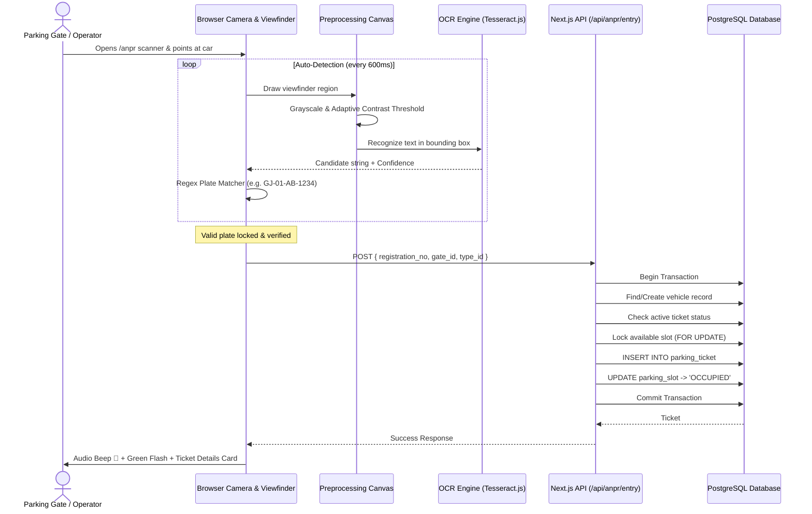

# 🚗 Implementation Plan: Camera ANPR & Automatic Database Storage

This plan outlines the end-to-end architecture and implementation steps to integrate a **live camera scanner** that automatically detects car license plates and records vehicle entries into the PostgreSQL parking database.

---

## 1. Overview & Architecture

### System Flow Diagram

---

## 2. Key Components to Implement

### A. Dedicated ANPR Camera Page (`/anpr`) & Navigation
- **URL**: `/anpr` (with a link added under "Operations" in [layout.tsx](file:///Users/rajdeepvala/code/DBMS/parking_management/web/src/app/layout.tsx)).
- **Integrated Option**: A "Camera Mode" toggle inside the existing [EntryForm.tsx](file:///Users/rajdeepvala/code/DBMS/parking_management/web/src/app/entry/EntryForm.tsx) for operators who want to switch between manual typing and camera scanning.
- **Controls & Configuration**:
  - Gate selection dropdown (e.g. *Gate 1 - North Zone Entry*).
  - Default vehicle type dropdown (*Car / 4-Wheeler*, *2-Wheeler*, etc.).
  - Operation mode toggle: **Instant Auto-Save** (saves immediately on match) vs **Confirm with 2s Timer** (shows recognized plate and counts down before saving).
  - Camera switch (Front / Back camera / USB webcam).
  - Test Image Upload button (allows testing with sample plate photos when an actual car is not present).

### B. Client-side Video & OCR Engine (`Tesseract.js`)
- **Package**: `tesseract.js` (WebAssembly-based, runs 100% locally in the browser with zero external API fees or backend Python dependencies).
- **Video Stream**:
  - `navigator.mediaDevices.getUserMedia({ video: { facingMode: "environment", width: { ideal: 1280 } } })`.
  - Scaled viewfinder overlay with targeting corners (`[  ]`) so the operator aligns the number plate.
- **Frame Preprocessing Pipeline**:
  - HTML5 Canvas captures the reticle area.
  - Grayscale conversion + Contrast Stretching (thresholding) to isolate dark characters on high-contrast backgrounds.
  - OCR configuration restricted to alphanumeric characters: `0123456789ABCDEFGHIJKLMNOPQRSTUVWXYZ-`.

### C. Plate Normalization & Pattern Validation
- Sanitizes OCR text (removes stray punctuation, normalizes spacing).
- Multi-tier regex matching:
  - **Indian Standard**: `^[A-Z]{2}[ -]?[0-9]{1,2}[ -]?[A-Z]{1,3}[ -]?[0-9]{4}$` (e.g., `GJ-01-AB-1234`, `DL-01-C-1234`, `MH-12-DE-5678`).
  - **BH Series**: `^[0-9]{2}BH[0-9]{4}[A-Z]{1,2}$` (e.g., `22BH1234AA`).
  - **General Format**: `^[A-Z0-9]{6,12}$` fallback for special/commercial plates.
- **Debounce & Cooldown Cache**:
  - Prevents re-scanning the same vehicle multiple times while it is sitting in the gate queue (e.g., 30-second cooldown per plate).

### D. Automated Database Entry Endpoint (`/api/anpr/entry`)
- Server-side handler with atomic PostgreSQL transaction:
  1. Normalizes `registration_no`.
  2. Queries `vehicle` table:
     - If not found, automatically inserts: `INSERT INTO vehicle (registration_no, type_id) VALUES (...)`.
  3. Checks `parking_ticket` for active tickets:
     - If already parked (`ticket_status = 'ACTIVE'`), returns status `ALREADY_PARKED` with existing ticket number.
  4. Queries and locks an available slot (`availability_status = 'AVAILABLE' FOR UPDATE`) in the zone associated with `entry_gate_id`.
     - If no slots free, returns status `NO_SLOTS_AVAILABLE`.
  5. Inserts into `parking_ticket` (`vehicle_id`, `slot_id`, `entry_gate_id`, `ticket_status = 'ACTIVE'`).
  6. Updates `parking_slot` (`availability_status = 'OCCUPIED'`).
  7. Revalidates Next.js cache paths (`/`, `/entry`, `/tickets`, `/slots`).
  8. Returns `{ success: true, ticket_no, slot_no, zone_name, registration_no, entry_time }`.

### E. Audio & Visual Operator Feedback
- **Web Audio API**: Synthetic audio chime / chime tone played immediately upon successful ticket creation (requires no external audio files).
- **Live Scanned Queue**: Sidebar displaying real-time scanned vehicles in the current session with ticket links, slot numbers, and status badges.
- **One-click Ticket Print / Details**: Direct link to `/tickets` or modal with printable receipt slip.

---

## 3. Implementation Status: COMPLETED ✅

| Step | Action | Status | Files Impacted |
| :--- | :--- | :--- | :--- |
| **1** | Install OCR dependency | ✅ Done | [package.json](file:///Users/rajdeepvala/code/DBMS/parking_management/web/package.json) (`tesseract.js`) |
| **2** | Create backend ANPR API endpoint | ✅ Done | [route.ts](file:///Users/rajdeepvala/code/DBMS/parking_management/web/src/app/api/anpr/entry/route.ts) |
| **3** | Build Canvas & Preprocessing utilities | ✅ Done | [anpr.ts](file:///Users/rajdeepvala/code/DBMS/parking_management/web/src/lib/anpr.ts) |
| **4** | Build Camera Scanner UI component | ✅ Done | [PlateScanner.tsx](file:///Users/rajdeepvala/code/DBMS/parking_management/web/src/components/PlateScanner.tsx) |
| **5** | Create ANPR Scanner Page | ✅ Done | [page.tsx](file:///Users/rajdeepvala/code/DBMS/parking_management/web/src/app/anpr/page.tsx) |
| **6** | Integrate camera toggle in Entry page | ✅ Done | [page.tsx](file:///Users/rajdeepvala/code/DBMS/parking_management/web/src/app/entry/page.tsx) |
| **7** | Add navigation entry | ✅ Done | [layout.tsx](file:///Users/rajdeepvala/code/DBMS/parking_management/web/src/app/layout.tsx) |
| **8** | End-to-end verification & automated testing | ✅ Done | Verified via API curl + Browser Subagent |

---

## 4. Verification Results

1. **API Database Transaction Tested**: Verified via `curl` to `/api/anpr/entry`.
   - New vehicle registration & automatic ticket creation succeeded with slot assignment.
   - Duplicate prevention correctly detected already parked vehicle (`ALREADY_PARKED`).
   - Slot capacity check verified when no slots are free (`NO_SLOTS`).
2. **Browser Validation Tested**:
   - Navigation link `📷 ANPR Scanner` operational.
   - Live reticle viewfinder with corner guidelines and status overlay functioning.
   - Continuous auto-detect toggle, manual capture button, and test photo upload all verified.

